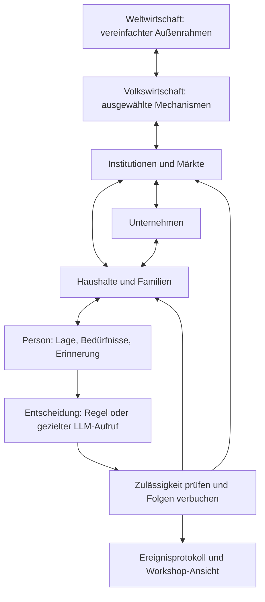

# Bauplan: Counterloom als Lernwelt für Investmententscheidungen

Version 0.1 · 2. November 2026 · Status: dokumentierter Arbeitsplan. System Dynamics ist der bevorzugte Modellierungsansatz; Framework, Bezugsraum und konkrete erste Lernmodule sind noch nicht ausgewählt. Keine neue Simulation durch diesen Plan gestartet.

## 1 · Ziel und vollständiger Zusammenhang

Eine reduzierte, über Zeit laufende Modellwelt macht sichtbar, wie eine Investmententscheidung mit persönlichen Bedürfnissen und wirtschaftlichen Systemen zusammenhängt. Sie dient Schülern in Finanzbildungs-Workshops: übersehene Risiken erkennen, andere Perspektiven verstehen, eigene Abwägungen reflektieren und frühere Entscheidungen unter ihrem damaligen Informationsstand nachvollziehen.

Die Weltwirtschaft bildet den schematischen äußeren Rahmen. Darin liegen Volkswirtschaften mit Staat, Zentralbank, Banken und Märkten. Unternehmen, Haushalte und Familien sind eigene Systeme. Personen treffen darin Entscheidungen, einschließlich der Entscheidung, nicht zu investieren. Verbindungen bestehen in beide Richtungen: persönliche Entscheidungen ändern Zahlungsströme; wirtschaftliche Bedingungen verändern persönliche Möglichkeiten.

Es geht um verständliche Zusammenhänge, nicht um eine vollständige Reproduktion der Welt oder die Vorhersage von Anlagepreisen. Die im Forschungsprozess genannten Ereignisse waren Beispiele für gewünschte Fähigkeiten, keine festgeschriebene Liste und keine vorgeschriebenen Wirkungsketten. Ein bestimmtes Stadtbild oder eine Schaltzentrale ist noch nicht beschlossen.

## 2 · Aufgenommenes Zielbild

| Bereich | Festgehaltene Anforderung |
|---|---|
| Systemebenen | Weltwirtschaft → Volkswirtschaft → Institutionen, Betriebe, Haushalte/Familien → Personen und Investmententscheidungen; Rückkopplungen zwischen Ebenen. |
| Population | Anleger und Nichtanleger; unterschiedliche Lebenslagen, Anlagezugänge, Erfahrungen und Dispositionen. Fallauswahl und empirische Repräsentativität unterscheiden. |
| Wirtschaftliche Möglichkeiten | Geldbestände, Besitz, Einnahmen, Ausgaben, gemeinsame Budgets, Schulden, Verpflichtungen und zulässige Finanzierung. |
| Wirtschaftsprozesse | Ausgewählte Mechanismen für Beschäftigung, Konsum, Investitionen, Preise, Zinsen, Staat und Geld/Schulden schrittweise ergänzen. |
| Zeit | Zustände und Erfahrungen bleiben erhalten. Gute Phasen, Belastungen und Übergänge sind ebenso möglich wie unveränderte Entwicklungen. |
| Eigenständigkeit | Regeln geben Möglichkeiten und Konsequenzen vor. Ein gewünschter Kauf, eine Panik oder ein Meinungswechsel wird nicht angeordnet. |
| Persona | Eher beständige Eigenschaften, aktuelle Lage, Erwartungen, Aufmerksamkeit und Absicht getrennt führen. Keine automatische psychologische Diagnose. |
| Kommunikation | Bei Bedarf individuelle Reflexion, Familien-/Unternehmensentscheidungen und Austausch in plausiblen Gruppen; tatsächliche Sichtbarkeit beachten. |
| Lernziel | Übersehene Möglichkeiten und Entscheidungsketten erkennen. Damalige Informationen von späterem Wissen trennen; kein vorgegebener „richtiger“ Anlagestil. |
| Darstellung | Laufende Zustände und Vorgänge sichtbar machen; Zeit steuern, Akteure untersuchen, Vorgeschichte und Varianten vergleichen. Darstellung offen. |
| Rechenaufwand | Regelmäßige Abläufe algorithmisch; LLMs gezielt und begrenzt für ausgewählte individuelle Entscheidungen. |
| Erkenntnisprüfung | Ein überraschender Text genügt nicht. Nachvollziehbarkeit, Vergleichsbedingungen, Parameterempfindlichkeit und Workshop-Lernen getrennt prüfen. |

## 3 · Modellierungsansatz

**System Dynamics** bildet Bestände, Flüsse, Verzögerungen und Rückkopplungen ab. **Zustandsmodelle und Ereignisse** ergänzen diskrete Vorgänge, zum Beispiel einen Vertragsbeginn oder einen Wechsel des Beschäftigungsstatus. **Generative Entscheidungskomponenten** können später ausgewählte Abwägungen übernehmen. Diese Architektur ist ein eigener Plan, keine schon geprüfte Kombination.

Die Ebenen sind verbunden, keine vollständig getrennten Kästen. Eine Familie ist nicht automatisch ein einzelner Mensch; mehrere Personen dürfen nicht unabhängig denselben gemeinsamen Geldbestand ausgeben. Arbeitgeber, Bank, Vermögensbesitz und soziale Kontakte sind unterschiedliche Beziehungen.

Aggregierte Ansichten und Detailansichten nutzen dieselben Zustände. Eine in Haushalte aufgeteilte Geldsumme darf nicht zusätzlich noch als unabhängiger Gesamtbestand verbucht werden. Eine Diagrammverbindung wird aktiviert, wenn ein protokollierter Modellvorgang vorliegt. Ein Informationskontakt, eine Zahlung und eine modellierte wirtschaftliche Wirkung benötigen unterscheidbare Verbindungstypen.

## 4 · Was berechnet wird und was entschieden wird

| Aufgabe | Geplante Ausführung | Grenze |
|---|---|---|
| Zeit, Zahlungstermine, Einnahmen/Ausgaben, Bestandsführung | Algorithmisch | Regeln, Einheiten, Gegenpositionen und Randbedingungen dokumentieren. |
| Zinsen, Gebühren, Tilgung, Vertragsabläufe | Algorithmisch nach dem gewählten Vertrag | Vertragsart, Gültigkeit, Verzögerung und institutionelle Ordnung beachten. |
| Aggregation und grafische Darstellung | Algorithmisch aus gespeicherten Vorgängen | Darstellung löst keine neuen Agentenentscheidungen aus. |
| Makroökonomische Reaktionsbeziehungen | Dokumentierte Gleichungen/Regeln; Zufall nur ausdrücklich und mit aufgezeichnetem Seed | Buchungsidentitäten sind verbindlich; Verhaltensannahmen und Parameter können umstritten oder unsicher sein. |
| Routinen und bestehende Spar-/Ausgabenpläne | Zunächst einfache überprüfbare Regeln | Als Vergleichsmethode kennzeichnen, keine empirische Häufigkeit erfinden. |
| Neuinterpretation einer Lage, Abwägung und Planänderung | Später optional LLM | Nur persönliche Sicht, tatsächliche Erinnerung und erlaubte Handlungen übergeben. |
| Familiengespräch, Unternehmensberatung, sozialer Austausch | Optionaler eigener Entscheidungs-/Kontaktvorgang | Keine allwissende Gruppenbesprechung und kein LLM-Aufruf pro Person und Zeitschritt als Standard. |
| Umsetzung einer Investmententscheidung | Regelkern prüft Antrag und verbucht Ausführung | Absicht, Auftrag, abgelehnter Auftrag und realisierter Besitz bleiben getrennt. |

System Dynamics schreibt nicht vor, welche ökonomische Theorie oder Gleichung richtig ist. Auch eine deterministische Regel kann eine unbelegte Annahme enthalten. Die Erklärung „Zins steigt, daher muss jede Person weniger sparen“ ist kein allgemeines Gesetz. Konkrete Kanäle, Verträge, Spielräume und alternative Reaktionen müssen im jeweils gewählten Lernmodul sichtbar sein.

Zustandsautomaten ergänzen kontinuierliche Bestände. Ein Statuswechsel führt nicht selbst zu einer korrekten Kontenführung. Finanzielle Kategorien wie „Zahlungslücke“ benötigen eine offen gelegte Definition; sie werden nicht unbemerkt in psychologische Kategorien wie „Panik“ übersetzt.

## 5 · Sparsamer Einsatz von LLMs

1. Der Modellkern kann ohne LLM laufen. Reguläre Zahlungen und bereits gültige Pläne werden weiter ausgeführt.
2. Ein Entscheidungspunkt entsteht durch ein relevantes neues Ereignis, aufgelaufene Veränderungen oder einen geplanten Überprüfungstermin. Kleine schleichende Veränderungen dürfen nicht dauerhaft durch eine Schwelle ausgeblendet werden.
3. Ein LLM erhält einen begrenzten persönlichen Zustand, zugestellte Informationen, ausgewählte Erinnerungen und zulässige Handlungen. Es bekommt weder den gesamten Weltzustand noch den künftigen Szenariopfad.
4. Es liefert einen strukturierten Antrag und eine zeitgleich gespeicherte Begründung. Die Begründung ist eine simulierte Selbstauskunft, kein unabhängiger psychologischer Ursachenbeweis.
5. Der Regelkern validiert den Antrag, reserviert gegebenenfalls gemeinsame Mittel, führt die Aktion aus oder lehnt sie mit Grund ab. Das tatsächliche Ergebnis gelangt in den Folgezustand.
6. Jeder Lauf hat vorab Grenzen für Anfragen, Kontext, Ausgabetokens, Zeit und gegebenenfalls Geldkosten. Diagnoseaufrufe und Wiederholungen zählen mit. Bei Erschöpfung stoppen oder eine vorab deklarierte einfache Vergleichsregel nutzen; Wechsel niemals verstecken.
7. Für die Workshop-Wiedergabe aufgezeichnete Entscheidungen nutzen. Pausieren, Zoomen und erneutes Ansehen kosten keine Modellaufrufe. Neue Gegenvarianten benötigen einen expliziten neuen Lauf.
8. Vollständig identische aufgezeichnete Zustände können für Replay wiederverwendet werden. Zwischengespeicherte Antworten dürfen echte unabhängige Wiederholungen nicht unbemerkt ersetzen oder zwischen unterschiedlichen Personas übertragen werden.

Von grob zu fein bedeutet zuerst mehr fachliche Details innerhalb klarer Systemgrenzen. Es bedeutet keine automatische, beliebige Verfeinerung sämtlicher Akteure im laufenden Versuch. Änderungen der rechnerischen Auflösung benötigen eine geprüfte Übertragung von Beständen und Verpflichtungen; bloßes grafisches Hineinzoomen verändert die Simulation nicht.

## 6 · Bausteine und Schnittstellen

| Baustein | Minimaler Vertrag |
|---|---|
| Systembeschreibung | Kennung, Typ, Zeitskala, Zustandsgrößen mit Einheiten, Ein-/Ausgänge, enthaltene Objekte und Beziehungen. |
| Regel/Verbindung | Auslöser, Voraussetzungen, Verzögerung, Berechnung, Ziel und Beleg beziehungsweise Annahmenkennzeichnung. |
| Ereignis | Kennung, Zeitpunkt, Quelle, Empfänger/Sichtbarkeit, betroffene Größen und Verweise auf vorangegangene Vorgänge. |
| Zustandsaufnahme | Zeitpunkt, Bestände, Verpflichtungen, aktive Pläne, Erinnerungsreferenzen, Versionen und Zufallszustand. |
| Entscheidung | Akteur, verfügbare Information, Alternativen, Antrag, Herkunft Regel/LLM, Begründung, Prüf-/Ausführungsergebnis und Ressourcenverbrauch. |
| Lernansicht | Ansichten derselben Daten auf verschiedenen Ebenen; Annahmen, beobachtete Modellereignisse und Agentenaussagen unterscheidbar. |

Diese Verträge beschreiben die benötigte fachliche Trennung. Sie sind noch keine implementierte API. Vorhandene Mechanismen eines gewählten Frameworks vorrangig wiederverwenden.

## 7 · Etappen und prüfbare Ergebnisse

| Etappe | Arbeit und Ergebnis | Voraussetzung für den nächsten Schritt |
|---|---|---|
| A · Lernumfang und Vorbilder | Eine konkrete Lernfrage, Systemgrenze, Bezugsraum und benötigte Mechanismen auswählen. BPTK-Py als erste technische Grundlage prüfen; Minsky als Vorbild für sichtbare Bestände/Finanzflüsse, etablierte Makromodelle als fachliche Referenzen. | Dokumentierte Fähigkeiten, Quellstand, Lizenz, Abhängigkeiten und Aufwand; begründete Auswahl oder Ablehnung. Kein Modelllauf allein wegen einer guten Demo. |
| B · Ein durchgängiger algorithmischer Lernpfad | Einen kleinen Ereignisweg über Systemgrenzen bis zu einem Haushaltsbudget und einem verfügbaren Anlagebetrag umsetzen. Beispiele erst in A auswählen. Bestände und zulässige Handlungen fortschreiben; zunächst keine LLMs. | Einheiten und Buchungen stimmen; Regeln und Annahmen sichtbar; Wiederholung und Zustandssicherung funktionieren. Die erste einfache Verlaufsansicht zeigt echte Modellvorgänge. |
| C · Unterschiedliche Ausgangslagen | Wenige dokumentierte Haushalts-/Personenfälle einschließlich Nichtanlegern ergänzen. Gemeinsame Haushaltsmittel, persönliche Sicht und einfache Entscheidungspolitiken prüfen. | Gleiche Ereignisse können wegen tatsächlich unterschiedlicher Lagen zu unterschiedlichen Möglichkeiten führen. Keine zufällig erfundenen Biografiefakten oder behaupteten Bevölkerungsgewichte. |
| D · Eine generative Entscheidung ergänzen | Den algorithmischen Zustand gezielt an eine Persona übergeben; strukturierten Antrag prüfen und umsetzen. Zunächst eine begrenzte Entscheidungsart, beispielsweise den bestehenden Anlageplan überprüfen. | Regel- und LLM-Variante sind vergleichbar; keine erfundenen Mittel, unzulässigen Transaktionen oder unbekannten Zukunftsinformationen. Verbrauch und Fehler vollständig dokumentiert. |
| E · Gegenvarianten und Grenzen | Dieselben Anfangszustände mit/ohne Veränderung und mit plausiblen Parameterbereichen prüfen. Wiederholungen und einfache Regeln als Vergleich verwenden. | Zusätzlicher Lernstoff lässt sich auf Zustände, Regeln, Informationen und Entscheidungen zurückführen. Keine bloß nachträglich plausibilisierte Geschichte. |
| F · Workshop-Ablauf | Pause, Zeitschritte, Auswahl einer Person, Ebenenwechsel, Erklärung der Verbindung und Replay/Gegenvariante zusammenführen. Schematische oder räumlichere Darstellung mit Schülern erproben. | Nutzer können einen Entscheidungsweg anhand der sichtbaren Belege erklären; Bewegungen und aggregierte Größen stimmen mit gespeicherten Vorgängen überein. |
| G · Pädagogisch prüfen und gezielt erweitern | Vorhersage-/Reflexionsaufgaben vor und nach einem kleinen Workshop vergleichen. Nur benötigte weitere Systeme, Ereignisse, soziale Interaktionen oder Anlageklassen ergänzen. | Nachweisbarer Nutzen gegenüber einem einfachen Schaubild oder einer angeleiteten Fallaufgabe; LLM-Zusatznutzen getrennt beurteilt. |

Etappen B–F bilden einen ersten vollständigen Ausschnitt vom äußeren Ereignis bis zur persönlichen Entscheidung. Eine eigene Weltwirtschaft mit vielen Ländern ist dafür nicht erforderlich. Das größere Ziel bleibt modular erweiterbar. Erste Schätzungen für Umsetzung und Rechenaufwand werden nach A anhand des gewählten Quellstands und einer gemessenen Minimalanbindung erstellt; es gibt noch keinen belastbaren Gesamttermin.

## 8 · Erster technischer Prüfauftrag

**Nächste konkrete Arbeit: BPTK-Py an einer festen Version untersuchen, noch ohne LLM.** Zu prüfen sind Bestände/Flüsse, Module, individuelle Zustände, Ereignisse/Verzögerungen, Rohdatenexport, Zeitschrittbetrieb, Wiederherstellung, reproduzierbarer Ablauf und Anschluss einer externen Entscheidung. Die Herstellerdokumentation nennt System Dynamics, agentenbasierte und hybride Modelle; die Agenten-API beschreibt zustandsabhängige Ereignisbehandlung. Dies sind bisher Dokumentationsbefunde, keine eigenen Tests.

Das Werkzeug liefert keine fertige, empirisch gültige VWL. Eigene Lernmodule brauchen weiter dokumentierte Beziehungen und Parameter. Bestehende Modelle und Unterrichtsvorbilder zuerst auf Wiederverwendung prüfen. BeforeIT/JMAB bleiben wirtschaftliche Referenz- oder spätere Erweiterungskandidaten. EconAgent bleibt wegen des alten technischen Stands vorwiegend methodische Referenz. Die vorhandenen Concordia-/TinyTroupe-Belege bleiben erhalten; sie erzwingen keinen weiteren Einsatz.

Für den ersten generativen Vergleich ist als vorläufige Größenordnung ein Ausschnitt mit vier ausgewählten Personen, sechs Perioden und zwei Bedingungen denkbar. Eine Obergrenze von 24 Modellanfragen einschließlich Diagnosen würde drei ausgewählte Entscheidungszeitpunkte je Person und Bedingung abdecken. Die genaue Zuteilung, Kontext-/Zeitgrenzen und der Abbruchfall werden vor Ausführung festgeschrieben; diese Skizze startet oder genehmigt keinen Lauf. Die algorithmische Welt kann dazwischen ohne Modellaufrufe weiterlaufen.

## 9 · Offene Entscheidungen und fachliche Grenzen

- **Erstes Lernziel und Systemgrenze:** gemeinsam aus dem Lernbedarf auswählen; die bisherigen Ereignisse sind illustrative Beispiele.
- **Bezugsraum:** Land/Währungsordnung, Verträge und Institutionen bestimmen die passenden Regeln. Noch nicht ausgewählt.
- **Population:** Datensätze für Lebenslage, Nichtanleger und psychologische Dimensionen recherchieren. Gemeinsame Verteilungen beachten; keine universelle Typologie unterstellen.
- **Handlungsraum:** Wer entscheidet im gemeinsamen Haushalt? Was ist ein Plan, ein Auftrag, ein Kauf, eine abgelehnte Aktion? Welche Gegenpartei führt eine Anlage aus?
- **Anlagepreise und Marktrückwirkung:** zunächst nachvollziehbare vorgegebene Preisverläufe möglich. Eigene Marktpreisbildung ist ein späterer, gesonderter Modellierungsaufwand.
- **Staat und Geldsystem:** nur für den gewählten Lernpfad relevante Mechanismen zuerst. Wenn Geldschöpfung, Staatsschulden oder Außenhandel beansprucht werden, die entsprechenden Gegenpositionen und Regeln vollständig abbilden.
- **Lernansicht:** Sektorboxen und aktivierte Verbindungen sind eine Option. Wirtschaftlicher Zustand und persönliche Entscheidung bleiben in jeder Darstellung miteinander verbunden.
- **Validität:** korrekte Buchungen, plausible Verhaltensregeln, empirische Passung und pädagogischer Nutzen sind verschiedene Nachweise. Kein bestimmtes Ergebnis als Beweis der Richtigkeit verwenden.

## 10 · Grundlagen und Herkunft

Der Systemumfang und die Priorität sparsamer LLM-Aufrufe beruhen auf dem festgehaltenen Projektziel. Die Etappen, Schnittstellen und Prüfgrenzen sind eigene Planungsvorschläge.

- [Anforderungen](research/requirements.md), [Prüfprotokoll](research/assessment-protocol.md), [Systementscheidung 0004](research/decisions/0004-reduced-hybrid-learning-model.md).
- [BPTK-Py: offizielle Übersicht](https://bptk.transentis.com/), [hybride Modelle](https://bptk.transentis.com/quickstart/hybrid/hybrid.html), [Agenten und Ereignisbehandlung](https://bptk.transentis.com/api/api_agent.html). Dokumentation am 2. November 2026 geprüft; kein eigener Runtime-Test. Die Bibliothek enthält auch dokumentierte Beer-Game-Beispiele als Unterrichts-/System-Dynamics-Vorbild, keine fertige Anlegersimulation.
- [Minsky: Godley Tables](https://minsky.sourceforge.io/manual/Ravel/node221.html). Ausgewählter offizieller Handbuchabschnitt zu Finanzflüssen geprüft; keine Integration oder Produktauswahl.
- [EZB: geldpolitische Transmission](https://www.ecb.europa.eu/mopo/intro/transmission/html/index.de.html). Quelle für Übertragungskanäle und unsichere Verzögerungen; kein vollständig determiniertes Kausalgesetz für einen einzelnen Haushalt.
- Bestehende wirtschaftliche Referenzen: [Quellenstand zur Makrowelt](sources/macroeconomic-world-2026-11-02.json). Nicht als bereits ausgeführte oder automatisch passende Alternativen behandeln.
