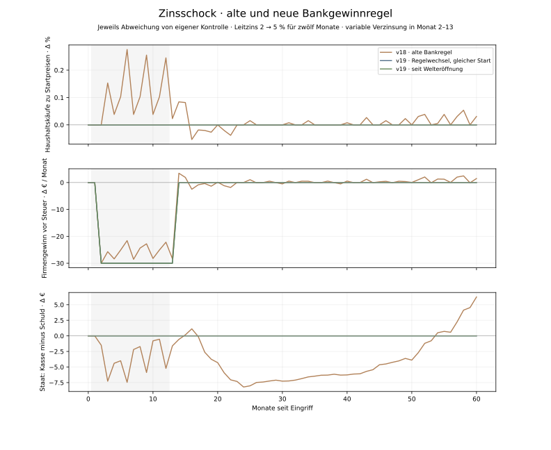

# Zinsschock nach konsistenter Bankgewinnrechnung

Stand: 3. November 2026. Eigene simulierte Befunde des Modells v19, keine Prognose. [Vorabplan](bank-profit-v19-plan.md), [Regeln](../poc/BANK_PROFIT_MODEL.md) und [vollständige Daten](bank-profit-v19-comparison.json). Der Investitionskanal ist unverändert.

## Vergleichsmethode

Der alte Zustand nach M1440 wird mit expliziter Legacy-Bankregel reproduziert. Die alte Kontrolle und der alte Zinsschock stimmen über alle 60 Monate in sämtlichen gespeicherten Monatsbeobachtungen mit dem v18-Archiv überein. Aus genau demselben Zustand starten auch neue Kontrolle und neuer Zinsschock. Die reine Umstellung ist damit von der Differenz Schock minus eigene Kontrolle getrennt. Die zusätzliche dritte Zeile startet bereits bei Welteröffnung mit der neuen Regel und hat nach M1440 folglich einen anderen Ausgangszustand.

## Erste zwölf Eingriffsmonate

| Variante | Erhaltenes Nettohaushaltseinkommen Δ | Haushaltskäufe zu Startpreisen Δ | Firmengewinn vor Steuer Δ | Staat netto am Ende Δ |
| --- | ---: | ---: | ---: | ---: |
| v18 · alte Bankregel | 136,83 € | 0,103 % | -281,91 € | -5,22 € |
| v19 · Regelwechsel, gleicher Start | 0,00 € | 0,000 % | -330,00 € | 0,00 € |
| v19 · seit Welteröffnung | 0,00 € | 0,000 % | -330,00 € | 0,00 € |

Alle Beträge sind kumulierte Flüsse gegenüber eigener Kontrolle; Staat netto ist die Stichtagsdifferenz von Kasse minus Schuld. Die höheren variablen Zinsen gelten in Monat 2–13: 330 € Mehrzinsen in den ersten zwölf Eingriffsmonaten, 360 € bis Monat 13.

## Bankgewinn und zeitlicher Rückfluss

| Variante | Zusätzliche Bankgewinnsteuer, zwölf Monate | Zusätzliche Bruttobankdividenden, zwölf Monate | Zusätzliche Bankrücklagen am Ende M12 |
| --- | ---: | ---: | ---: |
| v18 · alte Bankregel | 0,00 € | 330,00 € | 0,00 € |
| v19 · Regelwechsel, gleicher Start | 66,00 € | 264,00 € | 0,00 € |
| v19 · seit Welteröffnung | 66,00 € | 264,00 € | 0,00 € |

## Was die Korrektur erklärt

Im gleichen Ausgangszustand bleiben Haushaltskäufe und erhaltenes Nettoeinkommen in jedem der 60 Monate exakt gleich wie in der neuen Kontrolle. Der zuvor leicht positive Konsumeffekt verschwindet. Die Korrektur erzeugt keine allgemeine Nachfragedämpfung.

In den ersten zwölf Monaten sinkt die Firmengewinnsteuer durch den höheren Zinsaufwand um 66 €; die Bank zahlt genau 66 € zusätzliche Gewinnsteuer. Ihre Bruttodividenden steigen um 264 €, während die Bruttodividenden der Firmen um 264 € fallen. Nach der Quellensteuer heben sich zusätzliche Netto-Bankdividenden und geringere Netto-Firmendividenden mit jeweils 198 € auf. Löhne und sonstige Nettoeinkommen verändern sich dabei nicht. Die Beträge sind tatsächliche Journalvergleiche, keine eingefrorene Musterrechnung.

Diese Neutralität folgt im beobachteten Zustand aus den gleichen Eigentümern, gleichartiger Gewinnbesteuerung und den jetzt angeglichenen Auszahlungsregeln. Die Unternehmen können ihren Betrieb weiter finanzieren; neue Kredit- oder Investitionsentscheidungen werden durch den Schock hier nicht ausgelöst. Ein Geldfluss von Firma zur Bank ist damit noch kein Beleg für weniger gesamtwirtschaftliche Nachfrage. Beide Bankänderungen wurden gemeinsam umgesetzt; ihr separater kausaler Anteil wurde nicht in zusätzlichen Einzelvarianten geschätzt.

Die 25-%-Ausschüttungssteuer der Haushalte wird zusätzlich bei Auszahlung einbehalten. Die Bankrücklagen schwanken monatlich und werden zum Quartalsende freigegeben, soweit das geschützte Anfangseigenkapital erhalten bleibt. Ein Zwischenbestand ist keine dauerhafte Ersparnis- oder Wachstumswirkung.

## Gesamte 60 Monate

| Variante | Nettohaushaltseinkommen Δ | Haushaltskäufe zu Startpreisen Δ | Firmengewinn vor Steuer Δ | Staat netto am Ende Δ |
| --- | ---: | ---: | ---: | ---: |
| v18 · alte Bankregel | 173,16 € | 0,027 % | -295,80 € | 6,24 € |
| v19 · Regelwechsel, gleicher Start | 0,00 € | 0,000 % | -360,00 € | 0,00 € |
| v19 · seit Welteröffnung | 0,00 € | 0,000 % | -360,00 € | 0,00 € |

## Umstellung ohne Zinsschock

Allein die neue Bankregel verändert gegenüber der alten Kontrolle in den ersten zwölf Monaten das erhaltene Nettohaushaltseinkommen um -228,66 €, die Kaufmengen um -0,179 % und die staatliche Nettoposition am Ende um -7,92 €. Diese Umstellungseffekte sind nicht die oben ausgewiesenen Zinseffekte.

## Beobachtete Grenzen

Die steuerliche Sonderstellung der Bank und die sofortige Vollauszahlung sind entfernt. Bankgewinn bleibt ein vereinfachter zahlungsbezogener Zinsertrag ohne Bankbetriebskosten, Einlagenzinsen oder Risikovorsorge. Gleiches Eigentum an Firmen und Bank, die geringe variable Anfangsschuld und die fehlende zinsabhängige Investitionsentscheidung bleiben bestehen. Deshalb muss die Korrektur allein keine starke negative Konsumwirkung erzeugen. Die Vergleichswerte wurden nicht durch weitere Änderungen auf eine gewünschte Richtung eingestellt.

## Neue Referenz und technische Prüfung

- households, M1441–1500: 16.732,42 € bis 20.620,53 €.
- firms, M1441–1500: 34.245,25 € bis 38.739,61 €.
- government, M1441–1500: 89.716,25 € bis 90.461,43 €.
- bank, M1441–1500: 10.000,00 € bis 10.032,00 €.
- government_debt, M1441–1500: 0,00 € bis 0,00 €.

Beschäftigung im neuen ungestörten späten Verlauf: 6 bis 6 Verträge. Diese 60 beobachteten Monate nach 1440 Monaten Vorlauf sind keine Zusicherung unbegrenzter Stabilität.

205 Pythonprüfungen bestanden; 26 Phasenschnappschüsse vom neuen UI-Vertrag akzeptiert, acht gezielt beschädigte beziehungsweise veraltete Zustände zurückgewiesen. Frontend-Build erfolgreich. Im Browser wurden drei Monate einschliesslich Quartalsausschüttung ausgeführt und die neue Bankansicht geprüft.

Das Experiment prüft 14.400 Vorlaufphasen und 1.800 Fortsetzungsphasen. Jede neue Buchung wurde anhand der tatsächlichen Vorher-/Nachher-Konten unabhängig rekonstruiert. Die Berichtserzeugung gleicht zusätzlich Bankzins, Gewinnsteuer und Dividenden mit dem Journal sowie Haushaltseinkommen und staatliche Budgetsalden mit den Konten ab. Quellen und Archive werden per SHA-256 gebunden.

Reproduktion aus dem Repository-Stamm: `python poc/scripts/compare_bank_profit.py`, danach `python poc/scripts/report_bank_profit.py` mit Matplotlib. Die ursprünglichen v18-Archive bleiben unverändert.
