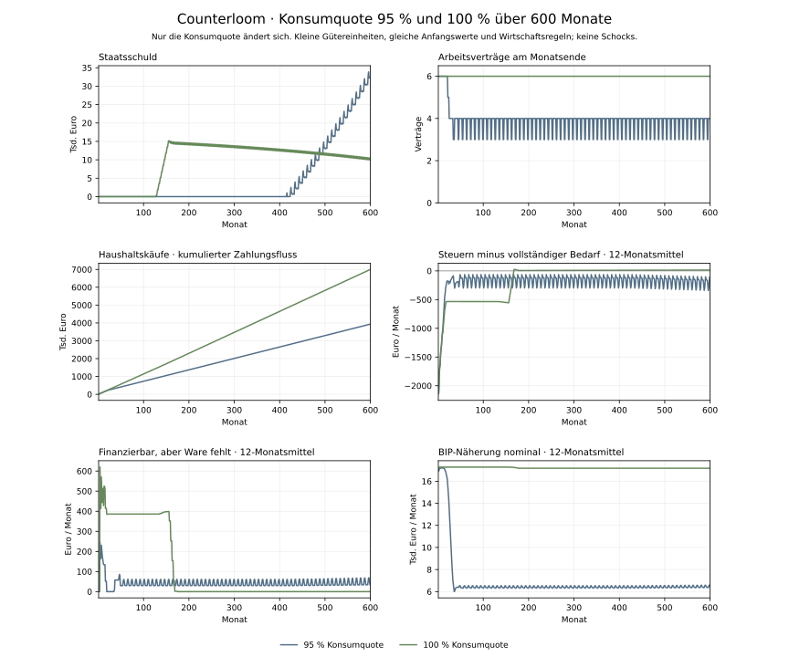

# Vergleich der Konsumquoten über 600 Monate

Stand: 3. November 2026. Eigener simulierter Befund im Modell v16.

Bei 100 % statt 95 % Konsumquote beträgt die Staatsschuld nach 600 Monaten 9.937,57 € statt 32.110,53 €. Am Ende bestehen 6 statt 4 Arbeitsverträge. In den letzten 120 Monaten beträgt der Bedarfssaldo bei 100 % durchschnittlich 13,03 €; bei 95 % liegt er bei -183,89 €.

## Kontrollierter Aufbau

Beide Läufe starten mit identischen Guthaben, kleinen Gütereinheiten, Zinssätzen, Krediten, 25 % Ausschüttungssteuer, adaptivem Staatsbudget und denselben Firmenentscheidungen. Nur die Quote im einkommensabhängigen Haushalts-Kaufplan wird vor dem ersten Monat von 95 auf 100 gesetzt. Mindestbedarf, Lagergrenzen, Kaufreihenfolge und alle weiteren Regeln bleiben erhalten. Es gibt keine Schocks. Die normale Oberfläche behält 95 % als Ausgangsquote.

100 % bezieht sich auf die Einkommensbasis, nicht auf das gesamte Vermögen. Es ist ein diagnostischer Gegenlauf, keine behauptete realistische Konsumregel. Fehlende Ware und Stückelung können weiterhin Ausgaben verhindern. Der Mindestbedarf kann bei geringerem Einkommen vorhandene Rücklagen beanspruchen.



## Endbestände und gesamte Käufe

| Kennzahl | 95 % | 100 % |
| --- | ---: | ---: |
| Staatsschuld M600 | 32.110,53 € | 9.937,57 € |
| Staatskasse M600 | 2.080,72 € | 5.426,25 € |
| Haushaltsguthaben M600 | 129.417,65 € | 87.569,40 € |
| Firmenguthaben M600 | 46.267,96 € | 46.283,85 € |
| Arbeitsverträge M600 | 4 | 6 |
| Davon öffentliche Stellen | 0 | 2 |
| Haushaltskäufe über alle Monate | 3.936.734,50 € | 6.999.195,00 € |

## Durchschnitt der Monate 481 bis 600

| Monatlicher Betrag | 95 % | 100 % |
| --- | ---: | ---: |
| Steuereinnahmen | 2.084,98 € | 5.440,59 € |
| Vollständiger laufender Bedarf | 2.268,87 € | 5.427,56 € |
| Saldo vor Finanzierung | -183,89 € | 13,03 € |
| Geplantes Zurückbehalten von Einkommen | 139,36 € | 0,00 € |
| Tatsächliche Haushaltsersparnis | 187,72 € | 6,63 € |
| Finanzierbare Käufe ohne verfügbare Ware | 42,79 € | 0,00 € |
| Rest wegen ganzer Warenteile | 5,22 € | 6,66 € |
| Ungedeckter Sozialbedarf | 0,00 € | 0,00 € |

## Interpretation

Die zeitlichen Verläufe unterscheiden sich deutlich: Der 100-%-Lauf nimmt bereits in Monat 128 Staatskredit auf, der 95-%-Lauf erst in Monat 415. Bei 100 % steigt die Schuld bis Monat 156 auf 15.151,29 Euro und sinkt anschliessend langfristig. Die erhaltenen öffentlichen Stellen verursachen anfangs weiterhin Ausgaben. Ein besserer Endbestand bedeutet daher keine geringere Kreditaufnahme in jedem einzelnen Monat.

Die geplante Zurückhaltung von Einkommen fällt im späten 100-%-Lauf vollständig weg. Gleichzeitig verschwinden dort die beobachteten Lieferlücken und die sechs Arbeitsverträge bleiben bestehen. Der Staat erzielt mehr Steuereinnahmen und finanziert eine andere Ausgabenstruktur. Der Saldo verbessert sich daher nicht bloss um den zuvor zurückbehaltenen Geldbetrag; die Unternehmens- und Staatsentscheidungen reagieren auf die veränderte Nachfrage.

Dieser Gegenlauf zeigt, dass die Konsumquote innerhalb der vorhandenen Regeln wesentlich zum bisherigen Defizit- und Beschäftigungsverlauf beiträgt. Die Verbesserung ist der Gesamteffekt der einen geänderten Annahme einschliesslich ihrer Rückkopplungen. Sie ist kein empirischer Nachweis, dass reale Ersparnis schädlich wäre oder eine Konsumquote von 100 % dauerhaft sinnvoll wäre. Ein kleiner später Überschuss und eine verbleibende Staatsschuld belegen auch keine unbegrenzte Stabilität.

Die Makroanzeige wird nur aus bereits ausgeführten Vorgängen berechnet und greift nicht in Entscheidungen ein. Die BIP-Näherung ist nominal und verwendet Lagerkosten sowie gezahlte öffentliche Löhne als vereinfachte Bewertungsansätze. Sie ist keine amtliche BIP-Rechnung; [Definitionen und Grenzen](../poc/MACRO_ACCOUNTS.md).

## Nachvollziehbarkeit

[Alle Monatswerte und Quellprüfsummen](consumption-v16-comparison-2026-11-03.json) · [Vorherige Defizitdiagnose](fiscal-balance-v15-diagnosis.md).

Der 95-%-Zweig reproduziert alle 600 archivierten feinen Abschlüsse bei Haushalts-, Firmen-, Staats- und Auslandsguthaben, Staatsschuld, Konsum, Beschäftigung, Steuern und vollständiger Budgetentscheidung exakt. Die Makroberechnung wird zusätzlich durch einen Lauf mit ausgeschalteter Beobachtung auf Einflussfreiheit geprüft.

```sh
poc/.venv/bin/python poc/scripts/compare_consumption.py --months 600
python poc/scripts/report_consumption.py --source .framework-review/consumption-comparison.json --output .framework-review/consumption-v16-comparison
```

Die Rohdaten speichern alle Monate beider Varianten und die Prüfsumme des Referenzarchivs. Die Abbildung glättet ausgewiesene Monatsgrössen über zwölf zurückliegende Werte; am Anfang werden entsprechend weniger Werte verwendet.
