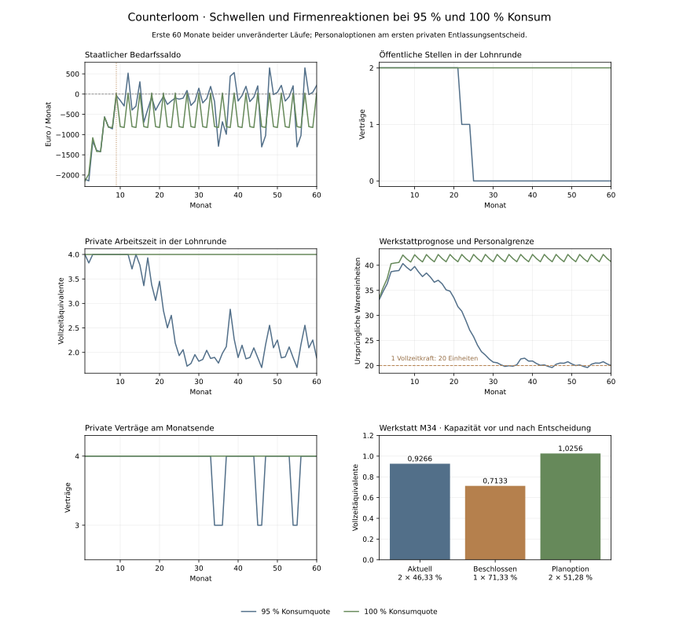

# Plausibilität der Firmenreaktionen bei unterschiedlichen Konsumquoten

Stand: 3. November 2026. Diagnose des bestehenden Modells v16; keine Verhaltensregel wurde verändert.

Die Wirkungsrichtung geringerer Käufe ist nachvollziehbar. Das grosse Ausmass und die wiederholten Personalwechsel werden aber durch harte Modellschwellen verstärkt. Die zwei fehlenden Arbeitsverträge im Endmonat des 95-%-Laufs sind öffentliche Stellen. Die privaten Firmen haben in beiden Endmonaten vier Beschäftigte. Im 95-%-Lauf schwankt der private Bestand zusätzlich wiederholt zwischen drei und vier.



## Wo die Pfade zuerst auseinanderlaufen

Bereits im ersten Monat führen die Quoten zu unterschiedlichen Käufen und Arbeitszeitplänen. Die privaten Firmen behalten in beiden Varianten zunächst zwei Arbeitskräfte je Betrieb. Die erste unterschiedliche strukturelle Staatsentscheidung entsteht in Monat 9:

| Monat 9 | 95 % Konsumquote | 100 % Konsumquote |
| --- | ---: | ---: |
| Wiederkehrende Steuern | 5.965,83 € | 6.021,70 € |
| Laufender Bedarf | 6.000,00 € | 6.000,00 € |
| Saldo | −34,17 € | +21,70 € |
| Beschaffungsquote ab M10 | 25 % | 50 % |

Die Einnahmen unterscheiden sich um nur 55,87 Euro. Bei 95 % liegt jedoch zum dritten Mal nacheinander ein negativer Abschluss vor. Das reduziert die Beschaffung ab dem Folgemonat um 600 Euro. Bei 100 % setzt der kleine positive Quartalsabschluss den Defizitzähler zurück. Die Regel unterscheidet weder nach Defizithöhe noch nach verfügbarer Kasse oder der Grösse des angekündigten Eingriffs. Quartalsausschüttungen und der Zeitpunkt ihres Steuerabzugs beeinflussen somit ebenfalls, ob drei negative Monate zusammenkommen.

Auch über alle drei Monate 7 bis 9 weisen beide Varianten ein Defizit aus: 1.701,11 Euro bei 95 % und 1.621,39 Euro bei 100 %. Der Einnahmenunterschied über das ganze Quartal beträgt nur 79,72 Euro. Die unterschiedliche Kürzung hängt also wesentlich an der Verteilung der Einnahmen auf einzelne Monate. Das Dreimonatsmittel der Einnahmen wird für Wiederaufbau geprüft, ist aber nicht der Auslöser der Kürzungen.

Im 95-%-Lauf wird in Monat 18 auch die restliche Beschaffung gestrichen. Die Entscheidungen in M21 und M24 beenden die öffentlichen Stellen ab M22 und M25. Die Salden der Entscheidungsmonate betragen −56,85 beziehungsweise −97,78 Euro; die Staatskasse enthält noch 67.370,14 beziehungsweise 66.847,83 Euro. Dies sind strukturelle Kürzungen der Regel, keine unmittelbar erzwungene Zahlungsunfähigkeit.

Weniger Aufträge und entfallende Löhne senken die Kaufbasis. Lohnsteuereinnahmen gehen verloren und Transferbedarf entsteht. Die Firmen sehen anschliessend geringere finanzierbare Bestellungen und reduzieren ihre Arbeitszeit. Im 100-%-Lauf bleiben dagegen beide öffentlichen Stellen erhalten. Eine weitere Beschaffungskürzung erfolgt dort erst in M156 bei einem Bedarfssaldo von −0,85 Euro. Schon dieser kleine Betrag kann die Schwelle auslösen.

## Die private Personalregel erzeugt einen zweiten Regelkreis

Der technische Personalwunsch wird aus der geglätteten Nachfrage geteilt durch die Kapazität einer Vollzeitkraft berechnet und auf ganze Arbeitskräfte aufgerundet. Zwei bestätigte Monate unter der bisherigen Besetzung genügen für eine Entlassung. Für diesen Schritt werden weder ein Verlust noch eine knappe Kasse verlangt. Arbeitszeit, Lagerziel und profitable Weiterbeschäftigung werden nicht als gemeinsame Alternativen abgewogen.

Die Werkstatt kann pro Vollzeitkraft 20 ursprüngliche Wareneinheiten herstellen. In M34 liegt ihre geglättete Nachfrage bei 19,95635 Einheiten, also knapp unter dieser Schwelle. Der Personalwunsch lautet deshalb eine statt zwei Arbeitskräfte. Der Monatsgewinn vor Steuer beträgt trotzdem 407,14 Euro; nach Gewinnsteuer stehen 23.752,90 Euro Kasse zur Verfügung.

| Werkstatt beim Abschluss M34 | Wert |
| --- | ---: |
| Bisherige Arbeitskräfte | 2 |
| Bisherige Arbeitszeit je Person | 46,33 % |
| Bisherige gesamte Arbeitszeit | 0,9266 Vollzeitäquivalente |
| Beschlossene Arbeitskräfte ab M35 | 1 |
| Neue Arbeitszeit je Person | 71,33 % |
| Neue gesamte Arbeitszeit | 0,7133 Vollzeitäquivalente |
| Planoption mit zwei Personen | je 51,28 %, zusammen 1,0256 Vollzeitäquivalente |

Die Grenze von 25 Prozentpunkten gilt je Person. Nach der Entlassung kann die verbleibende Person deshalb nicht sofort auf die nun benötigte volle Arbeitszeit wechseln. Die gesamte Kapazität sinkt um rund 23 %, obwohl die Nachfrageprognose nur rund 0,22 % unter der Ein-Personen-Vollzeitkapazität liegt. Das sind unterschiedliche Bezugsgrössen, kein gemessener Nachfrageeinbruch um 23 %.

Die Arbeitszeitoption mit zwei Personen wäre aus der vorhandenen Kasse finanzierbar und hat ebenfalls keine erwartete Finanzierungslücke. Die Personalzielregel wählt sie nicht. Zudem enthält der Produktionsplan eine Lagerauffüllung, die Personalzielzahl basiert dagegen nur auf dem Absatz. Damit verfolgen Personal- und Produktionsregler teilweise unterschiedliche Mengenanforderungen.

Die knappe Kapazität bedient die vorhandenen Bestellungen in M35 bis M37 nicht vollständig. Die Prognose nutzt verkaufte plus unerfüllte finanzierbare Bestellungen; eine Lieferlücke erhöht sie bei unverändertem Bestellvolumen nicht automatisch. Gleichzeitig verändern Arbeitszeit, Transfers und Ausschüttungen die Kaufbasis. Die geglättete Nachfrage überschreitet in M36 und M37 wieder die Ein-Personen-Grenze. In M37 stellt die Werkstatt die zweite Arbeitskraft erneut ein. Wegen derselben Arbeitszeitbegrenzung werden dann zwei Personen zu jeweils 75 % geplant: 1,5 Vollzeitäquivalente gegenüber zuvor 1,0. Lager und nachfolgende Arbeitszeit reagieren erneut. Diese Kombination aus aufgerundeter Personalzahl, Prognoseglättung, Lagerziel und begrenzter Arbeitszeit erklärt die beobachtete Schleife innerhalb der vorhandenen Regeln.

## Teilzeit und fester Transfer verändern die Nachfrage erneut

Der feste Transfer ist unabhängig von der vorherigen Arbeitszeit. h4 verdient in M34 nach Lohnsteuer 778,35 Euro bei Teilzeit. Nach der Entlassung erhält dieser Haushalt in M35 1.000 Euro Transfer. Gleichzeitig steigt der Nettolohn von h3 wegen der höheren Arbeitszeit von 778,35 auf 1.198,35 Euro. Zusammen steigen Lohn und Transfer der beiden Haushalte damit von 1.556,70 auf 2.198,35 Euro, ohne Ausschüttungen. Die Firmenlohnsumme sinkt trotzdem. Der Staat finanziert den zusätzlichen Transfer und verliert Lohnsteuer.

Dieser Gegenimpuls kann die Kaufbasis wieder erhöhen. Die tatsächlichen Kaufpläne hängen ausserdem von quartalsweisen Ausschüttungen, Mindestbedarf und anderen Haushalten ab; deshalb steigt die geglättete Firmenprognose nicht in jedem unmittelbar folgenden Monat. Die Höhe eines isolierten Transfereffekts wurde nicht durch einen separaten Eingriff gemessen. Die feste Transferhöhe gegenüber einem variablen Teilzeitlohn ist eine starke bestehende Modellannahme, die bei der Personalprüfung mitbetrachtet werden muss.

## Wie häufig diese Entscheidungen auftreten

| Private Personaländerungen über 600 Monate | 95 % | 100 % |
| --- | ---: | ---: |
| Entlassungsentscheidungen | 63 | 0 |
| Einstellungsentscheidungen | 63 | 0 |
| Entlassungen bei positivem Monatsgewinn | 63 | 0 |

Alle 126 privaten Personaländerungen des 95-%-Laufs betreffen die Werkstatt. Alle 63 Entlassungsentscheidungen treffen einen profitablen Betrieb mit mindestens 23.752,90 Euro Kasse nach aktueller Gewinnsteuer. Ein positiver Gewinn macht eine Entlassung nicht grundsätzlich unplausibel. Er zeigt hier aber, dass der Personalabbau nicht aus einer laufenden Verlust- oder Liquiditätsnot abgeleitet ist.

Eine weitere Vereinfachung verstärkt die Fragwürdigkeit des Zählziels: Eine Vollzeitkraft und zwei halbe Arbeitskräfte erzeugen im bestehenden Kostenmodell bei gleicher Gesamtarbeitszeit dieselbe Kapazität, Lohnsumme, Energie und Reserve. Es gibt keine fixen Kosten je Beschäftigtem, Rekrutierungskosten oder Abfindungen. Eine geringere Personenzahl hat damit allein keinen modellierten Kostenvorteil. Die unterschiedliche Gesamtarbeitszeit kann Kosten verändern; das ist vom reinen Wechsel der Kopfzahl zu unterscheiden.

## Einordnung anhand externer Evidenz

Ein EZB-Befund aus dem Economic Bulletin 4/2024 beschreibt, dass Unternehmen Beschäftigte trotz ungünstigerer Geschäftsaussichten halten und höhere Gewinnmargen dies erleichtern können. Das stützt die Relevanz finanzieller Puffer und unterschiedlicher Reaktionen. Es kalibriert weder unsere zwei Monate Bestätigung noch die 25-Prozentpunkte-Grenze und beweist nicht, dass eine bestimmte Modellfirma Personal halten muss. Quelle: [ECB Higher profit margins have helped firms hoard labour](https://www.ecb.europa.eu/press/economic-bulletin/focus/2024/html/ecb.ebbox202404_03~c65ab9309a.en.html), 2024; abgerufen am 3. November 2026.

## Gesamturteil und gezielte nächste Prüfungen

Plausible Grundbausteine sind geglättete Nachfrage, Lager, verzögerte Anpassung und finanzierte Arbeitspläne. Nicht ausreichend plausibilisiert sind die unabhängig geregelte Kopfzahl und Arbeitszeit, häufige kostenfreie Personalwechsel und die grossen fiskalischen Schritte an einer Null-Euro-Schwelle. Die geringe Zahl von sechs Haushalts-Arbeitskräften verstärkt einzelne Entscheidungen zusätzlich: Eine Stelle entspricht einem Sechstel der gesamten Besetzung.

Die grosse Abweichung zwischen 95 und 100 % ist daher kein belastbarer gesamtwirtschaftlicher Multiplikator. Sie enthält die Rückwirkung des Sparens sowie starke Schwellen- und Reihenfolgeeffekte unseres kleinen Modells. Die Diagnose trennt beobachtete Mechanismen, misst aber nicht den isolierten Anteil jedes Reglers am gesamten Endergebnis.

Vor neuen Wirtschaftssystemen sollten getrennte Gegenläufe zuerst die gemeinsame Planung von Vollzeitäquivalenten und Kopfzahl, dann die Reaktion des Staats auf kleine gegenüber grossen Defiziten untersuchen. Eine reine Anhebung der Konsumquote würde diese Fragen verdecken. Die vorliegende Fassung ändert keine dieser Regeln.

## Reproduktion und Prüfbarkeit

[Alle Monatsentscheidungen und betrachteten Personaloptionen](firm-reactions-v16-traces-2026-11-03.json) · [Ausgangsvergleich](consumption-v16-comparison.md) · [Firmenregeln](../poc/COMPANY_MODEL.md).

Beide 600-Monats-Verläufe reproduzieren die archivierten Käufe, Beschäftigung, Konten, Staatsschuld, Steuern und Budgetentscheidungen exakt. Die zusätzlichen Optionen werden auf Kopien berechnet; sie sind keine ausgeführten Gegenläufe. Ein gesonderter Vergleich zwischen beobachteter und unveränderter Welt prüft identische Buchungen und wirtschaftliche Historien.

```sh
poc/.venv/bin/python poc/scripts/diagnose_firm_reactions.py
python poc/scripts/report_firm_reactions.py --source .framework-review/firm-reaction-traces.json --output .framework-review/firm-reactions-v16-diagnosis
```

Die Rohdaten enthalten den Referenzhash, Quellprüfsummen, alle 2.400 Firmenabschlüsse, Prognosen, tatsächliche Entscheidungen und vier betrachtete Personaloptionen je Firma und Monat. Geldbeträge sind Cent; Mengen sind Hundertstel ursprünglicher Einheiten.
