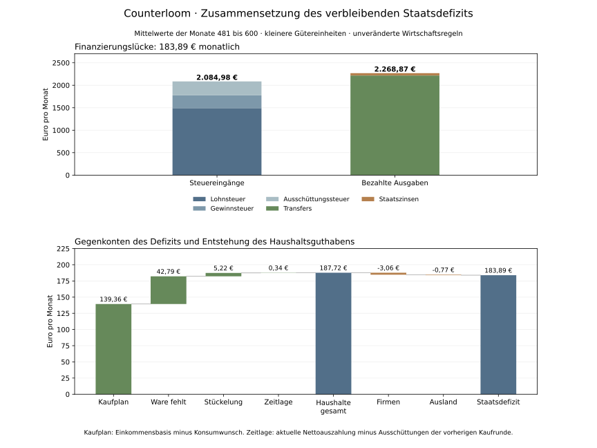

# Zusammensetzung des verbleibenden Staatsdefizits

Stand: 3. November 2026. Modell v15 verwendet die kleineren Gütereinheiten als Standard. Steuer-, Ausgaben- und Verhaltensregeln bleiben erhalten.

Der neue Standard reproduziert jeden der 600 Abschlüsse des bisherigen feinen Gegenlaufs. In Monat 481 bis 600 beträgt das Defizit durchschnittlich 183,89 €. Sämtliche Sozial-Referenzbeträge dieses Zeitraums werden bezahlt. Die Finanzierungslücke entspricht vollständig den zusätzlich aufgebauten Guthaben der anderen Sektoren.



## Einnahmen und Ausgaben pro Monat

| Monatsmittel | Betrag |
| --- | ---: |
| Lohnsteuer einschliesslich Nachzahlungen | 1.491,87 € |
| Gewinnsteuer | 285,04 € |
| Ausschüttungssteuer | 308,08 € |
| Alle Steuern | 2.084,98 € |
| Transfers | 2.216,67 € |
| Staatszinsen | 52,21 € |
| Öffentliche Löhne | 0,00 € |
| Beschaffung | 0,00 € |
| Alle laufenden Ausgaben | 2.268,87 € |
| Defizit | 183,89 € |

Bereits vor der Zinsausgabe fehlen bei den tatsächlich vorliegenden Steuereingängen durchschnittlich 131,68 €. Hinzu kommen 52,21 € bezahlte Zinsen. Diese Zerlegung ist eine Rechnung über den vorhandenen Lauf. Ein Lauf ohne Staatszinsen würde auch die Bankausschüttungen und Steuereingänge verändern; sein Nettoeffekt ist hier nicht gemessen.

Der Transferbedarf besteht aus jeweils 1.000 Euro für h5 und h6 sowie durchschnittlich 216,67 Euro für h4. Der vierte Haushalt ist in 26 der 120 Lohnrunden ohne Arbeit. Die Werkstatt wechselt wiederholt zwischen einer und zwei Arbeitskräften. Verträge und tatsächliche Arbeitszeit sind getrennt: Die zwei Beschäftigten im Alltagsbetrieb arbeiten im Mittel rund 53 % Vollzeit, die betriebliche Arbeitszeitquote der Werkstatt beträgt im Monatsmittel rund 59 %. Diese Werte beschreiben die laufenden Firmenentscheidungen bei der vorhandenen Nachfrage.

## Wo die Finanzierungslücke als Guthaben ankommt

| Veränderung der Guthaben pro Monat | Betrag |
| --- | ---: |
| Haushalte | 187,72 € |
| Unternehmen | -3,06 € |
| Ausland | -0,77 € |
| Bankeigenkapital | 0,00 € |

Die Haushalte bauen monatlich 187,72 € auf. Firmen und Ausland geben geringfügig Guthaben ab. Zusammengenommen entsprechen die Veränderungen exakt den 183,89 € Staatsdefizit. Der vollständige Monatslauf und jede einzelne Buchungsidentität wurden erneut geprüft.

Kredit finanziert die Lücke, ohne sie als Einnahme auszugeben. Von Ende Monat 480 bis Ende Monat 600 wächst die Staatsschuld um 22.118,36 Euro. Das kumulierte Defizit beträgt 22.066,70 Euro; die Differenz von 51,66 Euro erhöht die Staatskasse. Es gibt keinen zusätzlichen Maschinenkredit und das Bankkapital bleibt konstant.

## Warum die Haushalte Guthaben aufbauen

| Beitrag pro Monat | Betrag |
| --- | ---: |
| Einkommensbasis über dem gewünschten Kaufbudget | 139,36 € |
| Finanzierbar aber Ware fehlt | 42,79 € |
| Rest aus Stückelung | 5,22 € |
| Geldmangel gegenüber dem Kaufplan | 0,00 € |
| Zeitlage aktueller und vorheriger Ausschüttungen | 0,34 € |
| Tatsächliche Guthabenzunahme | 187,72 € |

Mittelwerte sind auf Cent gerundet; die Rohdaten rechnen mit ganzen Cent und prüfen die Gleichung vor jeder Mittelwertbildung exakt.

Die Konsumregel verwendet 95 % der Einkommensbasis, mindestens 1.000 Euro. Die Basis umfasst Lohn und Transfers nach Lohnsteuer sowie die Nettoauszahlungen seit der vorherigen Kaufrunde. Guthaben oberhalb des Grundbedarfs erhöht diesen einkommensabhängigen Plan nicht automatisch. Die Differenz zwischen Einkommensbasis und Konsumwunsch bleibt deshalb als geplantes Zurückbehalten erhalten; bei niedriger Basis kann der Mindestbedarf umgekehrt alte Rücklagen verbrauchen. Die tatsächliche Nettosumme dieser Planungswirkung beträgt hier 139,36 Euro monatlich.

Weitere 42,79 Euro könnten aus dem geplanten Budget bezahlt werden, treffen aber auf fehlende Ware. Kaufreihenfolge, Lager und geglättete Produktionsplanung erzeugen Lieferlücken auch dann, wenn Betriebe in anderen Monaten freie Kapazität haben. Die beobachteten Lieferlücken sind gemessen; welcher einzelne Firmenparameter sie verursacht, wird durch diese reine Buchungsdiagnose nicht isoliert. Die restliche Güterstückelung trägt nur 5,22 Euro bei.

Die kleinen 0,34 Euro aus der Zeitlage entstehen, weil der Kaufplan frühere Ausschüttungen nutzt, der Kontostand am Monatsende aber die neue Auszahlung enthält. Sie sind kein verschwundener Betrag und kein zusätzlicher Sparparameter.

## Haushalte einzeln

| Haushalt | Transfer pro Monat | Guthabenzuwachs pro Monat | Guthaben Ende M600 |
| --- | ---: | ---: | ---: |
| h1 | 0,00 € | 21,21 € | 13.604,25 € |
| h2 | 0,00 € | 10,84 € | 8.662,58 € |
| h3 | 0,00 € | 15,70 € | 12.868,31 € |
| h4 | 216,67 € | 9,30 € | 7.620,89 € |
| h5 | 1.000,00 € | 59,00 € | 39.568,38 € |
| h6 | 1.000,00 € | 71,67 € | 47.093,24 € |

h5 und h6 erhalten weiterhin den vollen 1.000-Euro-Transfer und gleiche Unternehmensanteile, obwohl ihre Guthaben steigen. Der Transfer kennt im bestehenden Modell keine Prüfung des Vermögens und keine Verrechnung von Ausschüttungseinkommen. Aus Transfer plus Nettoauszahlung wird wie bei den anderen Haushalten ein Kaufplan gebildet. Diese bestehenden Annahmen ermöglichen laufenden Guthabenzuwachs auch ohne Beschäftigung. Sie wurden für die Diagnose nicht verändert.

## Einordnung und nächste Prüfung

Das verbleibende Defizit lässt sich aus den vorhandenen Regeln und Zahlungen vollständig erklären. Die hohe grobe Rundung ist weitgehend beseitigt. Das Modell erlaubt nun weiterhin geplantes Zurückbehalten von Einkommen und begrenzte Warenkäufe, während der Staat Sozialleistungen und Zinsen finanziert. Eine Anlageentscheidung, die Haushaltsersparnisse wieder in zusätzliche reale Investitionen oder Nachfrage übersetzt, ist bislang kein eigener Haushaltsprozess. Eine Umbuchung auf ein anderes Finanzkonto allein würde die fehlende Nachfrage jedoch nicht ersetzen.

Die Sektorrechnung belegt die Gegenbuchungen, aber keine alleinige wirtschaftliche Ursache oder einen eindeutigen Eingriff. Zur weiteren Ursachentrennung wären kontrollierte Gegenläufe zu vorhandener Konsumquote, Grundbedarfsgrenze und Lieferlücken geeignet. In dieser Fassung wurde weder ein solcher Eingriff noch eine neue Steuer-, Transfer- oder Ausgabenregel eingebaut. Die 184 Euro sind der Durchschnitt des untersuchten Fensters, kein garantierter Wert für spätere Monate.

## Daten und Reproduktion

[Monatsdaten und exakte Zerlegungen](fiscal-balance-v15-diagnosis-2026-11-03.json) · [Vergleich der Stückelungen](goods-granularity-comparison.md) · [Modellumfang](../poc/WORLD_MODEL.md).

```sh
poc/.venv/bin/python poc/scripts/diagnose_fiscal_balance.py
python poc/scripts/report_fiscal_balance.py --source .framework-review/fiscal-balance-diagnosis.json --output .framework-review/fiscal-balance-v15-diagnosis
```

Die Diagnose startet die normale Konfiguration von v15. Sie vergleicht alle 600 Monate gegen den archivierten feinen Lauf und wertet anschliessend Monate 481 bis 600 aus. Rohdaten enthalten verwendete Quellenprüfsummen. Matplotlib ist nur für die Abbildung erforderlich.
