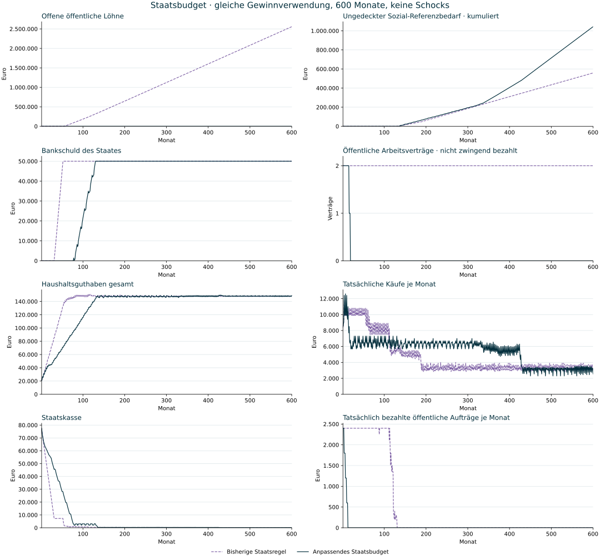

# Anpassendes Staatsbudget · 600-Monats-Vergleich

Stand: 3. November 2026. Simulierte Befunde aus einer kleinen illustrativen Modellwirtschaft, keine empirische Kalibrierung oder wirtschaftspolitische Empfehlung. Beide Varianten verwenden dieselben Anfangsbilanzen und dieselbe Gewinnverwendung mit zusätzlichen Quartalsausschüttungen. Steuersätze, Steuerbasis, Kreditrahmen, private Unternehmensregeln und Preise werden nicht zur Verbesserung des Ergebnisses geändert. Es gibt keine äusseren Schocks.



## Hauptbefund

**Die Regel verhindert neue unbezahlte öffentliche Löhne, saniert aber die Modellwirtschaft nicht.** Der Staat reagiert auf Defizite mit geringerer Beschaffung und schliesslich ohne öffentliche Arbeitsverträge. Dadurch entstehen weniger Lohnversprechen. Gleichzeitig steigen ungedeckte Sozialbedarfe; die Kreditgrenze wird später dennoch erreicht. Das ist keine kostenlose Beseitigung eines Defizits.

## Vergleich am Monatsende 600

| Kennzahl | Bisherige Staatsregel | Anpassendes Budget |
| --- | ---: | ---: |
| Offene öffentliche Lohnansprüche | 2.557.320,29 € | 0,00 € |
| Offene Staatszinsen | 0,00 € | 0,00 € |
| Bankschuld des Staates | 50.000,00 € | 50.000,00 € |
| Staatskasse | 143,10 € | 117,71 € |
| Haushaltsguthaben gesamt | 148.358,30 € | 148.838,02 € |
| Tatsächliche Käufe · Monat 600 | 3.150,00 € | 2.550,00 € |
| Öffentliche Arbeitsverträge | 2 | 0 |
| Aktuelle öffentliche Löhne bezahlt · Monat 600 | 6,78 € | 0,00 € |
| Sozial-Referenzbedarf · Monat 600 | 2.000,00 € | 4.000,00 € |
| Sozialleistungen tatsächlich bezahlt · Monat 600 | 646,07 € | 782,34 € |
| Sozial-Referenzbedarf ungedeckt · Monat 600 | 1.353,93 € | 3.217,66 € |
| Kumulierte ungedeckte Sozialbedarfe · keine gebuchte Schuld | 558.206,73 € | 1.042.634,33 € |
| Kreditgrenze erstmals erreicht | M53 | M130 |

Der Bedarfssaldo bleibt in der neuen Variante negativ, wenn der Staat seine laufenden Sozial-Referenzbeträge nicht finanzieren kann. Ausgebliebene Zahlungen machen die Planung nicht künstlich tragfähig. Die alte reine Zahlungsrechnung konnte ein kleines Plus zeigen, während Lohnansprüche weiter anwuchsen.

Die Soziallücke ist bewusst keine zusätzliche Schuldposition: Der Arbeitslosentransfer ist im Modell ein Referenzbedarf, fehlende Kurzarbeitsleistung bleibt dagegen ein Anspruch. Der Arbeitsstatus und damit die Zahl der transferberechtigten Haushalte unterscheiden sich zwischen den Varianten. Kumulierte Soziallücken und offene Lohnforderungen sind deshalb nicht dieselbe Grösse und dürfen nicht als identische Wohlfahrts- oder Schuldenmasse behandelt werden.

## Wann der Staat reagiert

| Abschluss | Entscheidung | Ab Monat | Stellenziel | Beschaffungsquote |
| --- | --- | ---: | ---: | ---: |
| M3 | Beschaffung reduzieren | 4 | 2 | 75 % |
| M6 | Beschaffung reduzieren | 7 | 2 | 50 % |
| M9 | Beschaffung reduzieren | 10 | 2 | 25 % |
| M12 | Beschaffung reduzieren | 13 | 2 | 0 % |
| M15 | Öffentliche Stelle abbauen | 16 | 1 | 0 % |
| M18 | Öffentliche Stelle abbauen | 19 | 0 | 0 % |

## Gesamter Verlauf statt nur Endmonat

| Tatsächlich bezahlter Fluss über 600 Monate | Bisherige Staatsregel | Anpassendes Budget |
| --- | ---: | ---: |
| Haushaltskäufe | 2.775.400,00 € | 3.236.250,00 € |
| Aktuelle öffentliche Löhne | 322.679,71 € | 79.200,00 € |
| Sozialleistungen | 390.793,27 € | 892.365,67 € |
| Öffentliche Warenaufträge | 285.550,00 € | 18.000,00 € |

Über den gesamten Lauf liegen die tatsächlichen Haushaltskäufe in der neuen Variante um 16.6 % höher, obwohl der einzelne Monat 600 niedrigere Käufe zeigt. Die frühere Begrenzung öffentlicher Ausgaben verschiebt verfügbare Mittel zu Sozialzahlungen und verändert die Nachfrageverläufe. Das ist eine Veränderung der Geldverwendung und des Umsatzes, keine zusätzliche Geldschöpfung.

Diese kumulierten Werte sind Zahlungsflüsse: Dasselbe Geld kann mehrfach ausgegeben werden. Haushaltskäufe sind zudem weder die gesamte Güternachfrage noch ein Wohlfahrtsmass; öffentliche Warenaufträge und der bisher nicht modellierte Nutzen öffentlicher Arbeit fehlen darin.

Die vorab festgelegte Regel kürzt nach drei Defizitabschlüssen zuerst die Beschaffungsquote um 25 Prozentpunkte. Bei bereits ausgesetzter Beschaffung kann nach drei weiteren Defizitabschlüssen eine öffentliche Stelle entfallen. Tatsächliche Monatsarbeit benötigt unabhängig davon vorab bestätigte Finanzierung. Wiederaufbau braucht drei positive Abschlüsse, wiederkehrende Deckung, Liquidität und gegebenenfalls freie Arbeitskräfte; er wird nicht erzwungen.

Im geprüften neuen Lauf entfallen die öffentlichen Stellen bereits vor einer vollständigen Erschöpfung der Staatskasse. Der Staat versucht also frühzeitig, strukturelle Defizite zu begrenzen. Die dadurch veränderten Einkommen und Aufträge schwächen aber auch Nachfrage und Steuereinnahmen. Reine Ausgabenkürzung löst die unzureichende Deckung hier nicht dauerhaft.

## Haushalte einzeln

| Haushalt | Guthaben bisher | Guthaben neu | Arbeitgeber neu | Sozialzahlung neu · M600 |
| --- | ---: | ---: | --- | ---: |
| h1 | 75.381,34 € | 67.623,12 € | Alltag & Versorgung | 0,00 € |
| h2 | 16.645,67 € | 251,47 € | ohne Arbeitsvertrag | 195,59 € |
| h3 | 55.258,95 € | 79.717,06 € | Werkstatt & Technik | 0,00 € |
| h4 | 404,49 € | 408,16 € | ohne Arbeitsvertrag | 195,59 € |
| h5 | 339,53 € | 415,39 € | ohne Arbeitsvertrag | 195,58 € |
| h6 | 328,32 € | 422,82 € | ohne Arbeitsvertrag | 195,58 € |

Ein annähernd gleiches Haushaltsguthaben insgesamt bedeutet keine ähnliche Lage aller Haushalte. Die neue anteilige Verteilung erreicht mehrere Haushalte, während die bisherige Reihenfolge bei knappen Mitteln einzelne zuerst bediente. Arbeitsplätze, laufende Einkommen und Guthaben bleiben jedoch stark ungleich verteilt. Gleiche Unternehmensanteile und die einfache Transferberechtigung ohne Vermögensprüfung sind weiterhin Modellannahmen.

## Was umgesetzt und geprüft wurde

- Defizitbestätigung und verzögerte Änderungen an Monatsgrenzen.
- Vollständig bestätigte Lohnfinanzierung vor aktueller öffentlicher Arbeit; kein neuer Lohnrückstand in jedem der 600 neuen Abschlüsse.
- Beendete Verträge statt verdeckter unbezahlter Arbeit. Neue private Beschäftigung entsteht nur aus den vorhandenen Firmenentscheidungen.
- Anteilige Sozialzahlungen und explizite ungedeckte Referenzbeträge.
- Alte Lohnansprüche bleiben bestehen und werden nur durch echte Überweisungen, einschliesslich Modellsteuer, reduziert.
- Der Referenzzweig stimmt in jedem Monat bei Haushalts-, Firmen-, Staats- und Auslandskonten, Bankschuld, Konsum, Produktion, Vertragszahl und offenen öffentlichen Löhnen exakt mit dem archivierten v12-Lauf überein.

## Grenzen und nächster Untersuchungsschritt

Die neue Regel ist ein nachvollziehbares Ausgaben- und Finanzierungsverhalten. Das Ende neuer Lohnrückstände ist als Software- und Buchungsziel erreicht, nicht als Nachweis einer gesunden Volkswirtschaft. Entfallene öffentliche Arbeit wird noch nicht in Dienstleistungen oder gesellschaftlichem Nutzen bewertet. Ein Rückgang öffentlicher Stellen darf daher nicht als Produktivitätsgewinn gelesen werden.

Für eine tragfähigere Staatsfinanzierung muss als nächster getrennter Gegenlauf die Einnahmen- beziehungsweise Verteilungsseite geprüft werden. Die derzeitige Steuerbasis erfasst Löhne und Firmengewinne, lässt Ausschüttungen steuerfrei und reagiert nur indirekt auf die Vermögenskonzentration. Eine breitere Steuerbasis wäre eine zusätzliche, ausdrücklich zu dokumentierende Modellannahme. Die bestehenden Regeln dürfen nicht einfach so nachjustiert werden, dass ein gewünschtes Gleichgewicht entsteht.

## Daten und Reproduktion

[Alle Monatswerte, Haushaltseinzelwerte, Budgetentscheidungen und Quellprüfsummen](fiscal-v13-comparison-2026-11-03.json). [Regeldefinition](../poc/PUBLIC_BUDGET_MODEL.md).

Vom Repository-Stamm mit eingerichteter Python-Umgebung:

```sh
poc/.venv/bin/python poc/scripts/compare_public_budget.py --months 600
```

Die Standardausgabe wird in `.framework-review/public-budget-comparison.json` geschrieben; der veröffentlichte datierte Befund wird nicht überschrieben. Der Batchlauf überspringt nur die Erstellung interaktiver Antworten, nicht Rechenschritte oder Kontrollen.

Abbildung erneut erzeugen, mit einer separaten Python-Umgebung mit Matplotlib:

```sh
python poc/scripts/report_public_budget.py --source qa/fiscal-v13-comparison-2026-11-03.json --output .framework-review/fiscal-v13-comparison
```
