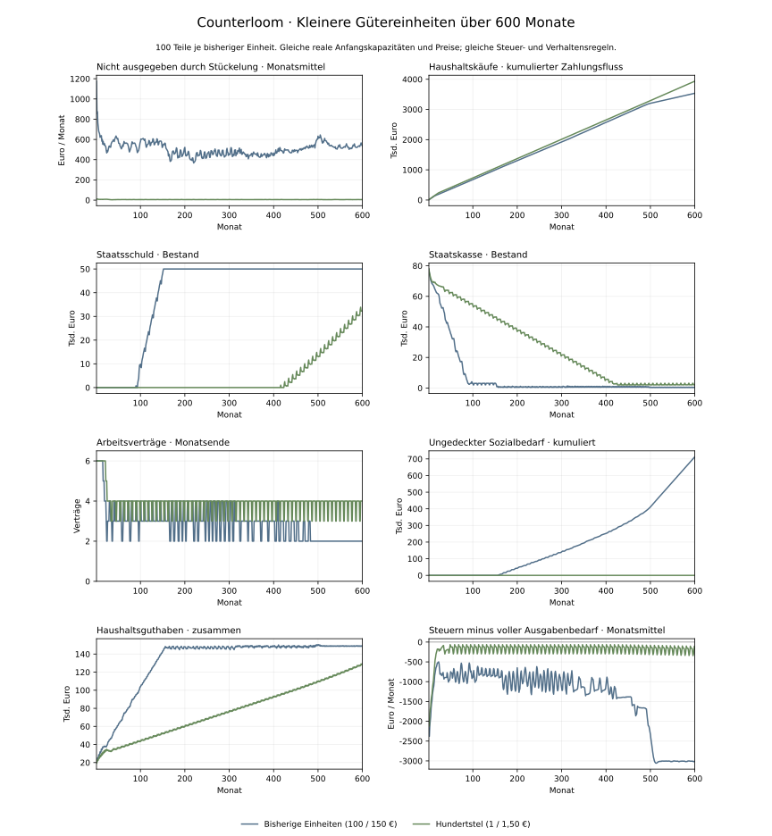

# Kleinere Gütereinheiten im Vergleich über 600 Monate

Stand: 3. November 2026. Simulierter Befund innerhalb der illustrativen Modellwirtschaft v14.

Mit Hundertsteln der bisherigen Gütereinheiten erreicht der Staat bis Monat 600 weder seine Kreditgrenze noch einen ungedeckten Sozialbedarf. Die Staatsschuld beträgt am Ende 32.110,53 € statt 50.000,00 €. Im Mittel der letzten 120 Monate verbleibt ein Defizit auf vollständiger Bedarfsbasis; eine dauerhaft ausgeglichene Wirtschaft ist damit nicht belegt.

## Vergleich und unveränderte Annahmen

Je eine bisherige Einheit wird durch 100 kleinere Einheiten ersetzt. Stückpreise werden von 100 beziehungsweise 150 Euro auf 1 beziehungsweise 1,50 Euro geteilt. Energie je Teil kostet ein Hundertstel; Arbeitsproduktivität, Anfangsabsatzpläne, Exportbestellungen, Maschinenmaterialbedarf und Maschinenkapazität werden mit 100 multipliziert. Ein Maschinenkauf kostet weiterhin 1.200 Euro und erhöht die ursprüngliche Kapazität um vier Einheiten. Geldbeträge werden weiterhin in ganzen Cent verbucht.

Anfangsguthaben, Kredite, Zinssätze, 30 % Lohnsteuer, 20 % Gewinnsteuer, 25 % Ausschüttungssteuer, Löhne, 1.000 Euro Transfer-Referenzbedarf, 95 % Konsumquote, Firmenentscheidungen und anpassende Staatsregel bleiben unverändert. Es gibt keine zusätzlichen Schocks oder LLM-Aufrufe. Beide Varianten durchlaufen 600 Monate mit jeweils fünf Phasen. Der normale Start behält die bisherige Stückelung.

Die geänderte Auflösung betrifft alle Warenkäufe sowie die Rundung von Absatzplänen, Produktion und Lager. Sie misst den Gesamteffekt feinerer Gütereinheiten. Der Anteil der Haushalts-Kaufrundung allein wird damit nicht separat identifiziert. Preise pro ursprünglicher Gütermenge und reale Anfangskapazitäten bleiben gleich; die späteren Mengen und Entscheidungen dürfen auf die geänderten Verkäufe reagieren.



## Ergebnisse nach 600 Monaten

| Grösse | Bisherige Einheiten | Hundertstel |
| --- | ---: | ---: |
| Staatsschuld | 50.000,00 € | 32.110,53 € |
| Staatskasse | 580,72 € | 2.080,72 € |
| Haushaltsguthaben zusammen | 149.145,28 € | 129.417,65 € |
| Firmenguthaben zusammen | 45.958,00 € | 46.267,96 € |
| Haushaltskäufe nur in Monat 600 | 3.300,00 € | 6.059,00 € |
| Arbeitsverträge am Monatsende | 2 | 4 |
| Staatskreditgrenze | Monat 152 | bis Monat 600 nicht erreicht |
| Erster ungedeckter Sozialbedarf | Monat 157 | bis Monat 600 nicht erreicht |

## Zahlungsflüsse und Rundungsreste

| Über alle 600 Monate | Bisherige Einheiten | Hundertstel |
| --- | ---: | ---: |
| Bezahlte Haushaltskäufe | 3.536.350,00 € | 3.936.734,50 € |
| Nicht ausgegeben durch Güterstückelung | 302.586,73 € | 3.200,34 € |
| Ungedeckter Sozial-Referenzbedarf | 712.571,97 € | 0,00 € |
| Tatsächlich gezahlte Steuern | 1.188.007,33 € | 1.308.540,93 € |

Die bezahlten Haushaltskäufe liegen insgesamt um 11,3 % höher. Der monatliche Stückelungsrest sinkt im Mittel von Monat 481 bis 600 von 543,28 € auf 5,22 €. Bereits im ersten Monat fällt er von 1.176 auf 12 Euro bei identischem finanzierbarem Kaufbudget.

Rundungsreste sind vorhandenes Geld, das aus einem finanzierbaren Kaufbudget nicht ausgegeben wird. Sie sind weder verschwundenes Geld noch automatisch ein gleich hoher Steuerausfall. Bei kumulierten Werten kann dasselbe Geld mehrfach als ungenutztes Budget auftauchen. Die Differenz der Restbeträge ist deshalb keine direkte Messung der vermiedenen Staatsschuld.

## Verbleibendes Defizit

| Monatsmittel von 481 bis 600 | Bisherige Einheiten | Hundertstel |
| --- | ---: | ---: |
| Steuereinnahmen | 1.241,66 € | 2.084,98 € |
| Vollständiger laufender Ausgabenbedarf | 4.100,00 € | 2.268,87 € |
| Saldo auf vollständiger Bedarfsbasis | -2.858,34 € | -183,89 € |

Im feinen Lauf werden alle Sozial-Referenzbeträge finanziert. Im groben Lauf sind die tatsächlich geleisteten Zahlungen begrenzt; ein annähernd ausgeglichener Zahlungssaldo dort ist keine Deckung des vollständigen Bedarfs. Im feinen Lauf bleibt die Kreditaufnahme zur Finanzierung fortlaufender Defizite erforderlich. Aus dem Befund bis Monat 600 folgt keine unbegrenzte Tragfähigkeit.

## Wirkung innerhalb des Modells

Das erste Kaufbudget ist in beiden Varianten gleich. Der feinere Verkauf lässt davon mehr als Umsatz bei den Unternehmen ankommen. Nachfolgende Absatz-, Arbeitszeit-, Personal- und Steuerentscheidungen reagieren nach denselben bestehenden Formeln auf andere Zahlungseingänge. Im feinen Lauf sinkt die Zahl öffentlicher Stellen erstmals in Monat 22 statt 16; am Ende gibt es in beiden Varianten keine öffentlichen Stellen. Die vier Arbeitsverträge im feinen Endmonat liegen im privaten Sektor.

Die grobe Stückelung beeinflusst den bisherigen Krisenverlauf damit erheblich. Sie erklärt jedoch nicht das gesamte verbleibende Defizit. Das Ergebnis rechtfertigt weitere Prüfung der vorhandenen Annahmen und ihrer Auflösung, ohne zusätzliche fiskalische Regeln einzubauen. Es ist ein kontrollierter Softwarebefund innerhalb dieser Modellwirtschaft, kein empirischer Nachweis realer Wirtschaftswirkungen.

## Reproduktion und Belege

[Alle Monatswerte mit Haushaltsbudgets und Firmenplänen](goods-granularity-comparison-2026-11-03.json) · [Ausgangslauf mit Ausschüttungssteuer](tax-v14-comparison.md) · [Einheiten und Prüfregeln](../poc/GOODS_GRANULARITY_EXPERIMENT.md).

Der Referenzlauf reproduziert alle 600 archivierten Monatsabschlüsse bei Geldbeständen, Staatsschuld, Konsum, Produktion, Beschäftigung, Steuereinnahmen und Budgetentscheidungen exakt. Die Rohdaten enthalten Quellprüfsummen und die Prüfsumme des verwendeten Referenzarchivs.

```sh
poc/.venv/bin/python poc/scripts/compare_goods_granularity.py --months 600
python poc/scripts/report_goods_granularity.py --source .framework-review/goods-granularity-comparison.json --output .framework-review/goods-granularity-comparison
```

Matplotlib wird nur für die Abbildung benötigt. Standardausgaben liegen unter `.framework-review`; archivierte Befunde werden nicht überschrieben. Die beiden Glättungskurven verwenden zwölf zurückliegende Monatswerte, am Laufanfang entsprechend weniger.
