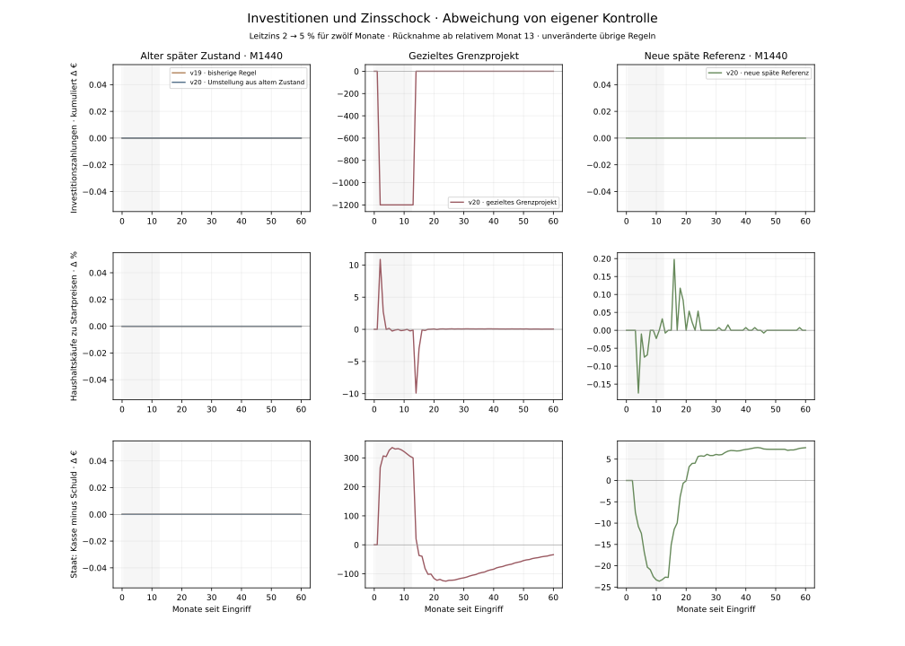
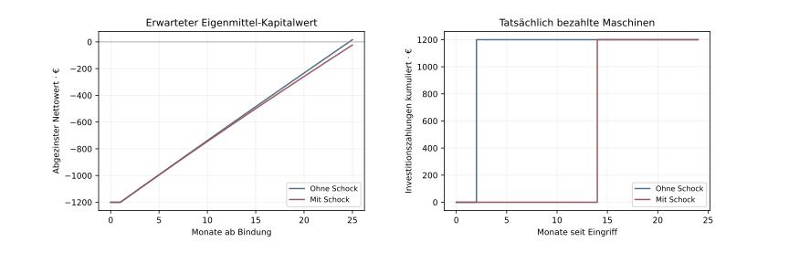

# Investitionsprüfung und erneuter Zinsschock

Stand: 3. November 2026. Eigene simulierte Befunde und Erwartungsrechnungen, keine Prognose. [Vorabplan](investment-v20-plan.md), [Modellregeln](../poc/INVESTMENT_MODEL.md), [vollständiges Ergebnisarchiv](investment-v20-comparison.json).

## Abgrenzung und Vergleich

Die neue Regel bewertet den bestehenden Maschinenfall Alltag & Versorgung → Werkstatt & Technik. Erwartete zusätzliche Verkäufe und eingesparte Arbeitszeit werden gegen Energie, Steuern, Kaufpreis und Finanzierung gerechnet. Eigenmittel erhalten einen ausdrücklich angenommenen Bewertungszins in Höhe des Modell-Leitzinses; dies erzeugt keine Einlagenzinsen. Die Kreditrechnung enthält tatsächliche vertragliche Zinsen und volle Tilgung des bestehenden begrenzten Maschinenvertrags. Es wird weder eine neue Branche noch ein allgemeiner Kreditmarkt eingeführt.

Die alte Investitionsregel wird bis M1440 reproduziert. Anker und beide alten 60-Monats-Fortsetzungen müssen mit dem archivierten v19-Lauf übereinstimmen. Aus demselben Zustand laufen alte/neue Investitionsregel jeweils ohne/mit Schock. Eine neue Referenz verwendet die Bewertung seit Welteröffnung. Der zusätzliche Grenzfall wird nach dem vorab festgelegten Kriterium aus dem ungestörten Verlauf ausgewählt; er ist kein repräsentativer Durchschnittseffekt.

## Schock minus eigene Kontrolle, erste zwölf Monate

| Vergleich | Investitionszahlungen Δ | Erhaltenes Nettohaushaltseinkommen Δ | Kaufmengen Δ | Firmengewinn vor Steuer Δ | Staat netto am Ende Δ |
| --- | ---: | ---: | ---: | ---: | ---: |
| v19 · bisherige Regel | 0,00 € | 0,00 € | 0,000 % | -330,00 € | 0,00 € |
| v20 · Umstellung aus altem Zustand | 0,00 € | 0,00 € | 0,000 % | -330,00 € | 0,00 € |
| v20 · gezieltes Grenzprojekt | -1.200,00 € | 1.031,73 € | 0,916 % | -750,35 € | 305,38 € |
| v20 · neue späte Referenz | 0,00 € | -51,24 € | -0,031 % | -353,94 € | -23,25 € |

Flüsse sind kumuliert; Staat netto ist die Stichtagsdifferenz Kasse minus Schuld. Unterschiedliche Ausgangszustände werden jeweils mit eigener Kontrolle verglichen. Die variable Altverzinsung folgt mit einem Monat Verzögerung.

## Investitionsgelegenheit und tatsächliche Lieferung

Das erste tatsächlich finanzierbare Grenzprojekt liegt in Monat 113. Die vollständigen Zustände vor diesem Monat sind identisch. Erwarteter monatlicher Nachsteuer-Mehrertrag: 51,84 €; Maschinenpreis: 1.200,00 €.

| Erwartungsrechnung beim ersten Entscheid | Ohne Schock | Mit Schock |
| --- | ---: | ---: |
| Eigenmittel-Kapitalwert, 2 beziehungsweise 5 % | 16,58 € | -23,27 € |
| Kredit-Kapitalwert, Angebot 6 beziehungsweise 9 % | 0,55 € | -32,26 € |

Ohne Schock: tatsächlich bezahlte und gelieferte Maschinen M114 (1.200,00 €).
Mit Schock: tatsächlich bezahlte und gelieferte Maschinen M126 (1.200,00 €).

## Warum Konsum und Beschäftigung anders reagieren können

Im gezielten Grenzfall ändert sich das tatsächlich erhaltene Nettohaushaltseinkommen während zwölf Monaten um 1.031,73 €: 477,10 € aus Einkommen vor Eigentümerausschüttungen und 554,63 € aus Netto-Eigentümerausschüttungen. Die Käufe verändern sich um 1.503,00 €; mangels Ware unerfüllte Kaufpläne um -960,00 €. Diese Zerlegung wird direkt aus den Monatsbelegen berechnet.

Die neue Maschine ist hier überwiegend eine Automatisierung bei gegebener Nachfrage. Ihr Aufschub vermeidet zunächst Arbeitszeitersparnis und kann deshalb Löhne erhöhen. Nicht für eine Maschine gebundene beziehungsweise ausgezahlte Mittel können Eigentümerausschüttungen verändern. Zusätzlich konkurrieren Maschinen- und Haushaltskäufe um begrenzte Werkstattware. Die Lieferantennachfrage und die Haushaltsnachfrage sind daher nicht automatisch zusätzliche Produktion. Diese Gegenwirkungen werden nicht mit einer neuen Regel unterdrückt.

Der Versuch weist einen wirksamen Bewertungs- und Investitionszeitpunktkanal nach. Er validiert keine allgemeine Konsum- oder BIP-Wirkung höherer Leitzinsen. Finanzierungsart im tatsächlich beobachteten Grenzfall: Eigenmittel; das Kreditangebot daneben ist eine geprüfte Alternative, keine im Lauf gebuchte Kreditaufnahme. Die ungestörte Auswahl eines Grenzprojekts macht den Test gezielt sensitiv und erlaubt keine Aussage zur Häufigkeit solcher Projekte.

## Gesamte 60 Monate

| Vergleich | Investitionszahlungen Δ | Nettohaushaltseinkommen Δ | Kaufmengen Δ | Firmengewinn vor Steuer Δ | Staat netto am Ende Δ |
| --- | ---: | ---: | ---: | ---: | ---: |
| v19 · bisherige Regel | 0,00 € | 0,00 € | 0,000 % | -360,00 € | 0,00 € |
| v20 · Umstellung aus altem Zustand | 0,00 € | 0,00 € | 0,000 % | -360,00 € | 0,00 € |
| v20 · gezieltes Grenzprojekt | 0,00 € | 143,80 € | 0,008 % | -1.020,24 € | -34,20 € |
| v20 · neue späte Referenz | 0,00 € | 17,29 € | 0,004 % | -356,37 € | 7,69 € |

## Warum manche Vergleiche trotzdem kleine Zinseffekte zeigen

Bei Umstellung aus dem alten Zustand kaufen beide neuen Zweige über 60 Monate Maschinen für 12.000,00 € beziehungsweise 12.000,00 €. Die Bewertung ändert die Investitionsregel, doch die Projekte im zwölfmonatigen Zinsfenster bleiben in beiden Zweigen wirtschaftlich. Null Differenz bedeutet hier nicht, dass keine Investitionen stattfinden. In der seit Welteröffnung ausgebauten neuen Referenz werden während der 60 Folgemonate keine weiteren Maschinen gekauft; der geringe verbleibende Zinseffekt entsteht daher ohne neue Maschineninvestition. Bereits installierte Kapazität wird durch eine Zinserhöhung nicht zurückgenommen.

## Neue Langzeitreferenz und Grenzen

Neue Regel ab Welteröffnung: 1440 Monate Vorlauf und 60 weitere Kontrollmonate. Die Bestandsbereiche unten zeigen die letzten 120 Vorlaufmonate und die 60 Fortsetzungsmonate; sie sind keine Zusicherung unbegrenzter Stabilität. Automatisierung kann bei fester Bevölkerung und begrenzter Nachfrage Arbeitszeit und Stellen verringern. Neue Branchen, steigende Reallöhne, Demografie, Ersatzinvestitionen und allgemeine Preis-/Lohnanpassung werden dadurch noch nicht modelliert.

- households: 12.697,71 € bis 17.562,49 €.
- firms: 25.617,74 € bis 30.799,25 €.
- government: 101.289,90 € bis 102.597,52 €.
- government_debt: 0,00 € bis 0,00 €.
- bank: 10.000,00 € bis 10.032,00 €.

Beschäftigung im späten Kontrollbereich: 6 bis 6 Verträge. Höchste unbezahlte soziale Monatsleistung in M1441–1500: 0,00 €. Die neue Referenz kann sich strukturell von v19 unterscheiden; ein gleiches Beschäftigungsniveau oder Staatsbudget wird nicht erzwungen.

## Technische Nachweise

213 Pythonprüfungen bestanden, darunter acht gezielte Investitionsprüfungen. 28 tatsächliche Phasen-/Projektzustände werden vom UI-Vertrag akzeptiert; acht beschädigte beziehungsweise veraltete Zustände werden zurückgewiesen. Frontend-Build erfolgreich. Die Ansicht wurde im Browser bis zur realen Bestellung geprüft.

Alle Fortsetzungsbuchungen wurden zusätzlich zu den Modellprüfungen unabhängig anhand der Vorher-/Nachher-Konten rekonstruiert. Haushaltseinkommen minus Käufe entspricht der Kontoveränderung, staatliche Nettopositionsänderung dem Budgetsaldo und der Warenfluss der Lageränderung. Die Berichtserzeugung prüft Quell- und Archivprüfsummen sowie Kapitalwert-/Ratenfelder.

Reproduktion: beide Teile von [compare_investment.py](../poc/scripts/compare_investment.py) mit --part late beziehungsweise --part new und separatem --output berechnen, mittels [collect_investment.py](../poc/scripts/collect_investment.py) zusammenführen und [report_investment.py](../poc/scripts/report_investment.py) mit Matplotlib ausführen. [Erwartungsrechnung im Code](../poc/investment.py). Frühere Archive bleiben unverändert.
