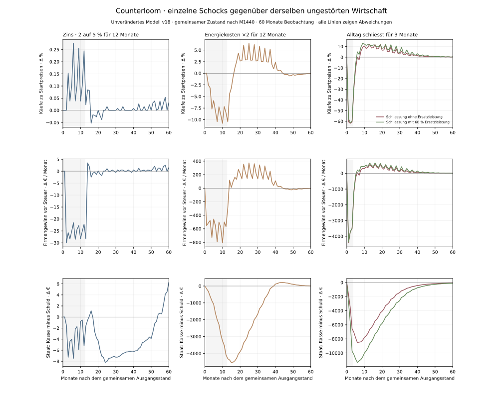
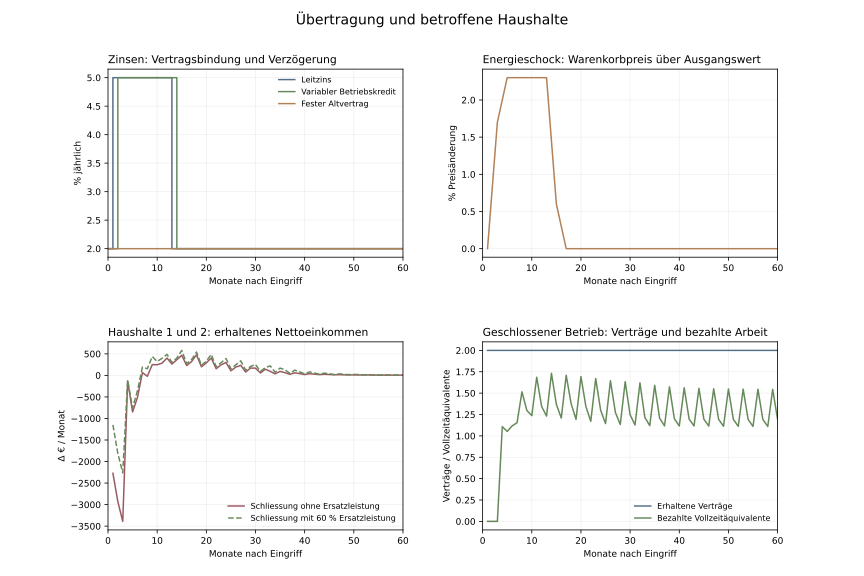

# Reaktionen auf einzelne Schocks

Stand: 3. November 2026. Eigene simulierte Befunde im unveränderten Modell v18; keine Prognose realer Haushalte oder Volkswirtschaften.

Fünf getrennte Fortsetzungen starten aus demselben vollständig berechneten Zustand nach M1440: ein ungestörter Kontrollverlauf, höhere Leitzinsen, höhere Energiekosten und dieselbe Betriebsschliessung mit beziehungsweise ohne Kurzarbeitsleistung. Vorlauf und Kontrolle reproduzieren die wirtschaftlichen Vergleichsfelder des archivierten Referenzlaufs.

Die Energiekosten belasten Gewinne, Arbeitszeit und Kaufmengen deutlich; die zu Startpreisen bewerteten Käufe liegen während der zwölf Eingriffsmonate 6,72 % unter der Kontrolle. Die Schliessung trifft den Konsum kurzfristig noch stärker. Die Ersatzleistung mindert den Einkommensausfall, kann aber die fehlende Ware nicht ersetzen. Der Zinsschock bleibt klein und leicht konsumsteigernd; der unten ausgewiesene Ausschüttungsweg der Bank ist dabei ein wichtiger Gegenimpuls.



## Eingriffe und unmittelbare Folgen

| Eingriff | Eingriffsmonate | Erhaltenes Nettohaushaltseinkommen kumuliert Δ | Käufe zu Startpreisen Δ | Firmengewinn vor Steuer kumuliert Δ | Staat netto am Ende des Eingriffs Δ |
| --- | ---: | ---: | ---: | ---: | ---: |
| Leitzins 2 auf 5 % | 12 | 136,83 € | 0,10 % | -281,91 € | -5,22 € |
| Energiekosten verdoppelt | 12 | -7.229,29 € | -6,72 % | -7.023,41 € | -4.088,79 € |
| Schliessung ohne Ersatzleistung | 3 | -13.822,09 € | -60,96 % | -11.644,33 € | -6.550,08 € |
| Schliessung mit 60 % Ersatzleistung | 3 | -10.118,70 € | -59,38 % | -11.569,77 € | -9.738,75 € |

Alle Abweichungen beziehen sich auf denselben Kalendermonat der Modellkontrolle. Zins und Energie werden nach zwölf Monaten zurückgenommen; der Betrieb öffnet nach drei Monaten. Summierte Flüsse über drei und zwölf Monate sind deshalb keine gleich langen Belastungen. Käufe zu unveränderten Startpreisen sind ein Mengenindikator für die zwei Modellwaren, kein amtlicher realer Konsum.

## Haushalte

Nettoeinkommen bedeutet hier tatsächlich erhaltene Löhne und Transfers nach Lohnsteuer plus aktuelle Netto-Eigentümerausschüttungen. Der Kaufplan verwendet dagegen die seit der vorherigen Kaufrunde verfügbaren Ausschüttungen. Diese zeitliche Trennung erklärt, warum Einkommensänderung und Käufe nicht im selben Monat gleich reagieren müssen.

| Schock und Haushalt | Nettoeinkommen während Eingriff Δ | Käufe zu Startpreisen während Eingriff Δ | Kontostand nach 60 Monaten Δ | Niedrigster Kontostand |
| --- | ---: | ---: | ---: | ---: |
| Leitzins 2 auf 5 % · h1 | 24,00 € | 28,00 € | -0,95 € | 2.790,62 € |
| Leitzins 2 auf 5 % · h2 | 23,97 € | 28,00 € | -2,44 € | 2.790,24 € |
| Leitzins 2 auf 5 % · h3 | 31,36 € | 28,50 € | -0,89 € | 2.789,38 € |
| Leitzins 2 auf 5 % · h4 | 31,36 € | 28,50 € | -0,93 € | 2.789,10 € |
| Leitzins 2 auf 5 % · h5 | 13,07 € | 13,00 € | 0,41 € | 2.790,95 € |
| Leitzins 2 auf 5 % · h6 | 13,07 € | 13,00 € | -0,54 € | 2.791,09 € |
| Energiekosten verdoppelt · h1 | -1.225,29 € | -1.441,50 € | -6,29 € | 2.769,13 € |
| Energiekosten verdoppelt · h2 | -1.225,31 € | -1.441,50 € | -7,32 € | 2.768,79 € |
| Energiekosten verdoppelt · h3 | -1.686,98 € | -2.008,00 € | 0,12 € | 2.768,71 € |
| Energiekosten verdoppelt · h4 | -1.686,97 € | -2.008,00 € | 1,23 € | 2.768,71 € |
| Energiekosten verdoppelt · h5 | -702,36 € | -1.066,50 € | -0,55 € | 2.769,13 € |
| Energiekosten verdoppelt · h6 | -702,38 € | -1.066,50 € | -1,15 € | 2.768,82 € |
| Schliessung ohne Ersatzleistung · h1 | -4.294,55 € | -3.161,50 € | -10,80 € | 2.302,42 € |
| Schliessung ohne Ersatzleistung · h2 | -4.294,54 € | -3.161,50 € | -11,30 € | 2.302,08 € |
| Schliessung ohne Ersatzleistung · h3 | -1.548,07 € | -3.552,50 € | 25,12 € | 2.817,56 € |
| Schliessung ohne Ersatzleistung · h4 | -1.548,06 € | -3.552,50 € | 18,15 € | 2.809,34 € |
| Schliessung ohne Ersatzleistung · h5 | -1.068,43 € | -3.525,00 € | 20,20 € | 2.812,95 € |
| Schliessung ohne Ersatzleistung · h6 | -1.068,44 € | -3.525,00 € | 25,62 € | 2.818,97 € |
| Schliessung mit 60 % Ersatzleistung · h1 | -2.611,81 € | -2.971,00 € | 2,32 € | 2.795,02 € |
| Schliessung mit 60 % Ersatzleistung · h2 | -2.611,80 € | -2.971,00 € | 1,35 € | 2.795,10 € |
| Schliessung mit 60 % Ersatzleistung · h3 | -1.386,57 € | -3.480,50 € | 42,11 € | 2.834,39 € |
| Schliessung mit 60 % Ersatzleistung · h4 | -1.386,57 € | -3.480,50 € | 18,13 € | 2.807,66 € |
| Schliessung mit 60 % Ersatzleistung · h5 | -1.060,97 € | -3.522,00 € | 17,95 € | 2.808,89 € |
| Schliessung mit 60 % Ersatzleistung · h6 | -1.060,98 € | -3.522,00 € | 38,35 € | 2.831,90 € |

Haushalte 1 und 2 arbeiten vor dem Eingriff bei Alltag & Versorgung, 3 und 4 bei Werkstatt & Technik, 5 und 6 beim Staat. Alle sechs besitzen im bestehenden Modell gleiche Firmenanteile. Ausschüttungen können deshalb auch nicht unmittelbar betroffene Haushalte erreichen.

## Unternehmen

| Schock und Betrieb | Erlöse während Eingriff Δ | Gewinn vor Steuer Δ | Lohnzahlungen Δ | Energiezahlungen Δ | Zinszahlungen Δ |
| --- | ---: | ---: | ---: | ---: | ---: |
| Leitzins 2 auf 5 % · alltag | 74,00 € | -292,26 € | 31,20 € | 3,55 € | 330,00 € |
| Leitzins 2 auf 5 % · werkstatt | 70,50 € | 10,35 € | 52,32 € | 3,96 € | 0,00 € |
| Energiekosten verdoppelt · alltag | -1.953,55 € | -4.170,85 € | -1.494,24 € | 3.811,55 € | 0,00 € |
| Energiekosten verdoppelt · werkstatt | -2.130,24 € | -2.852,56 € | -2.813,28 € | 3.583,44 € | 0,00 € |
| Schliessung ohne Ersatzleistung · alltag | -20.741,00 € | -11.385,17 € | -9.217,44 € | -136,90 € | 0,00 € |
| Schliessung ohne Ersatzleistung · werkstatt | -1.851,00 € | -259,16 € | -1.370,40 € | -102,78 € | 0,00 € |
| Schliessung mit 60 % Ersatzleistung · alltag | -20.741,00 € | -11.385,17 € | -9.217,44 € | -136,90 € | 0,00 € |
| Schliessung mit 60 % Ersatzleistung · werkstatt | -1.320,00 € | -184,60 € | -930,24 € | -69,75 € | 0,00 € |

Eine angeordnete Schliessung erhält zunächst Verträge. Die betroffene Firma zahlt währenddessen keine Arbeitslöhne und produziert beziehungsweise verkauft keine Ware. Erhaltungsenergie und Schuldendienst laufen weiter. Ein unveränderter Vertragsbestand bedeutet daher keine unveränderte Arbeit oder Einkommenslage.



## Staat und verbleibende Folgen

| Eingriff | Steuereinnahmen während Eingriff Δ | Kurzarbeitszahlungen während Eingriff Δ | Staat netto nach 60 Monaten Δ | Käufe zu Startpreisen über 60 Monate Δ | Käufe in den letzten zwölf Monaten Δ | Höchste Staatsschuld |
| --- | ---: | ---: | ---: | ---: | ---: | ---: |
| Leitzins 2 auf 5 % | -5,22 € | 0,00 € | 6,24 € | 0,03 % | 0,02 % | 0,00 € |
| Energiekosten verdoppelt | -4.101,64 € | 0,00 € | 5,71 € | -0,31 % | -0,24 % | 0,00 € |
| Schliessung ohne Ersatzleistung | -7.450,08 € | 0,00 € | -59,58 € | -0,22 % | 0,31 % | 0,00 € |
| Schliessung mit 60 % Ersatzleistung | -7.288,17 € | 3.350,58 € | -101,47 € | 1,23 % | 0,50 % | 0,00 € |

Kasse minus Schuld wird gemeinsam beurteilt. Ein Schock kann die vorhandene Staatskasse belasten, ohne sofort neue Staatsschulden auszulösen. Die Differenz zur Kontrolle nach 60 Monaten zeigt verbleibende Bestandseffekte; sie ist kein über 60 Monate aufsummierter Bestand.

In allen fünf Zweigen bleiben sechs Arbeitsverträge bestehen. Die bezahlte Arbeitszeit verändert sich trotzdem. Kein Zweig nimmt neuen Staatskredit auf; die Belastungen werden aus vorhandener Kasse getragen. Im Kurzarbeitszweig beträgt der niedrigste monatliche Kassenabschluss 78.806,07 €.

Der grösste Abstand der staatlichen Nettoposition zur Kontrolle tritt im Kurzarbeitszweig erst in Monat 6 nach Eingriff auf: -11.332,83 €. Das ist eine Abweichung vom Vergleich, kein negativer absoluter Kontostand. Steuer- und Nachfragereaktionen laufen nach Wiederöffnung weiter.

## Aussagegrenzen der drei Übertragungswege

Der Zinsschock erhöht allein die Zinszahlung auf den variablen Betriebskredit von 12.000 Euro rechnerisch um 30 Euro je belastetem Monat. Der feste Altvertrag bleibt bei 2 %. Über die gesamte Nachbeobachtung betragen die zusätzlichen tatsächlich gezahlten Firmenzinsen 360,00 €. Haushaltskredite und verzinste Sparguthaben fehlen. Eine kleine gesamtwirtschaftliche Reaktion ist deshalb eine Grenze dieses Modellausschnitts, kein Beleg für eine generell geringe Wirkung realer Leitzinsen.

Während der zwölf Leitzinsmonate verändern sich die Netto-Bankausschüttungen um 247,47 €, Netto-Firmenausschüttungen um -169,08 € und die übrigen Nettoeinkünfte um 58,44 €. Diese drei tatsächlich gebuchten Komponenten erklären die Einkommensänderung. Die Bank schüttet ihre vereinnahmten Zinsen im bestehenden Modell an dieselben sechs Haushalte aus; höhere Zinskosten sind deshalb nicht nur ein Geldabfluss aus deren Wirtschaftskreislauf.

Beim Energieschock erreicht der Modell-Warenkorbpreisindex höchstens 102,30 gegenüber 100 im Ausgangszustand. Die bestehende Regel gibt nur einen Teil der Mehrkosten verzögert weiter. Nominale Ausgaben, reale Warenmengen und Gewinne werden deshalb getrennt betrachtet.

Bei der Schliessung bleibt ein Teil der gewünschten Käufe mangels Ware unausgeführt. Dieses Geld bleibt auf den Konten und kann nach Wiederöffnung zusätzliche Nachfrage auslösen. Es gibt weder freie Umschichtung des gesamten Kaufbudgets auf die andere Ware noch separat modellierte unvermeidbare Haushaltsmieten und Versicherungen. Die Kontoreaktion bildet daher nicht jede reale Notlage nach; ein Wohlfahrtsverlust zeitlich ausgefallener Käufe wird nicht bewertet. 60 % Kurzarbeitsleistung beziehen sich auf den beim Schliessungsbeginn eingefrorenen Referenz-Nettoarbeitslohn, nicht auf sämtliche Haushaltseinkünfte.

Der gewählte Schliessungseingriff zerstört keine Anlagen und beendet keine Verträge. Die beobachtete Annäherung an den Kontrollverlauf nach Rücknahme ist deshalb kein Nachweis, dass reale Krisenschäden vollständig nachgeholt werden. Es wird kein empirischer Fiskalmultiplikator aus diesen Versuchen abgeleitet.

## Nachweise und Reproduktion

[Vorab festgelegter Versuchsplan](isolated-shocks-v18-plan.md) · [Monatsdaten und kompakter Zahlungsnachweis](isolated-shocks-v18-2026-11-03.json) · [Prüfprotokoll](isolated-shocks-v18-verification.json).

Fünf neue Tests prüfen Beobachtungsneutralität, die identische Kontrollfortsetzung, isolierte Zustandskopien sowie Zins-, Energie- und Schliessungsgrenzen. Jede der 1.500 Fortsetzungsphasen behält die Kernprüfungen und eine zusätzliche unabhängige Rekonstruktion aller neuen Buchungen. Der gemeinsame Vorlauf umfasst 7.200 weitere geprüfte Phasen. Haushaltseinkommen minus Käufe wird zusätzlich mit der Kontoveränderung abgeglichen; beim Staat entspricht die Änderung von Kasse minus Schuld dem tatsächlichen Budgetsaldo.

```sh
python -m unittest discover -s poc -p test_isolated_shocks.py -v
python poc/scripts/isolated_shocks.py
python poc/scripts/report_isolated_shocks.py
```

Das Diagramm benötigt Matplotlib. Vor der Berichtserzeugung werden Quell- und Referenzprüfsummen, alle fünf Zweige und sämtliche neuen Gegenbuchungen geprüft. Die laufende Oberfläche und ihre Regeln wurden für diese Offlineversuche nicht verändert.
