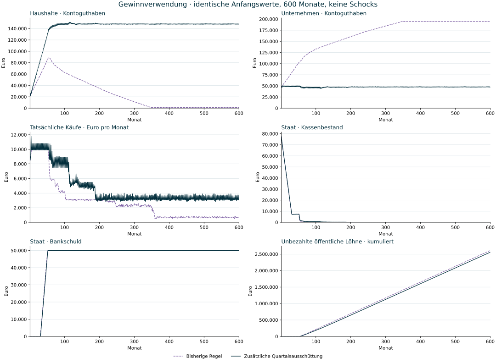

# Gewinnrücklagen und zusätzliche Ausschüttungen · 600-Monats-Vergleich

Stand: 3. November 2026. Simulierte Befunde, keine empirische Kalibrierung oder Prognose. Zwei Läufe beginnen mit denselben elf Akteuren und Anfangsbilanzen. Es gibt keine äusseren Schocks. Nur das Regelpaket der Gewinnverwendung unterscheidet sich; Staats-, Steuer-, Preis-, Personal- und Kreditregeln bleiben gleich. Endogene Reaktionen dürfen sich unterscheiden.



## Ergebnis nach 600 Monaten

| Kennzahl | Bisherige Regel | Neue Gewinnverwendung |
| --- | ---: | ---: |
| Haushaltsguthaben gesamt | 1.196,22 € | 148.358,30 € |
| Firmenguthaben gesamt | 194.632,78 € | 47.125,60 € |
| Tatsächliche Käufe im Monat 600 | 700,00 € | 3.150,00 € |
| Staatskasse | 0,00 € | 143,10 € |
| Bankschuld des Staates | 50.000,00 € | 50.000,00 € |
| Unbezahlte öffentliche Löhne | 2.610.066,91 € | 2.557.320,29 € |
| Unbezahlte Staatszinsen | 30.005,03 € | 0,00 € |

Der zusätzliche Rückfluss begrenzt im geprüften Lauf die Ansammlung von Geld bei den Unternehmen deutlich. Die Firmen halten am Ende zusammen ungefähr ihren Anfangsbestand von 48.000 €; positive, nicht benötigte Gewinne fliessen regelmässig an ihre Eigentümer. Die neue Regel verteilt das Anfangskapital nicht automatisch aus.

**Die Staatsfinanzierung ist damit nicht gelöst.** Eine positive Restkasse ist kein Beleg für Zahlungsfähigkeit: Die neue Variante weist weiterhin unbezahlte öffentliche Löhne in Millionenhöhe aus. Die bestehende Staatsregel reduziert ihre Lohnversprechen bei fehlender Finanzierung nicht und zahlt ältere Lohnrückstände nicht automatisch nach. Der tatsächliche Haushaltssaldo erfasst bezahlte Ausgaben; ausbleibende Zahlungen können ihn scheinbar verbessern. Bankschuld, Kasse und offene Verpflichtungen müssen gemeinsam gelesen werden.

## Haushalte einzeln

| Haushalt | Guthaben bisher · M600 | Guthaben neu · M600 | Arbeitgeber neu · M600 |
| --- | ---: | ---: | --- |
| h1 | 438,01 € | 75.381,34 € | Alltag & Versorgung |
| h2 | 182,65 € | 16.645,67 € | ohne Arbeitsvertrag |
| h3 | 159,62 € | 55.258,95 € | Werkstatt & Technik |
| h4 | 125,12 € | 404,49 € | ohne Arbeitsvertrag |
| h5 | 141,77 € | 339,53 € | Staat |
| h6 | 149,05 € | 328,32 € | Staat |

Im neuen Lauf halten die zwei liquidesten Haushalte zusammen 88.1 % des Haushaltsguthabens; 3 Haushalte verbleiben unter 500 €. Der höhere Sektorsaldo bedeutet deshalb keine flächendeckende Absicherung.

Die Sektorsumme ersetzt keine Aussage über jeden Haushalt. Die sechs Modellhaushalte besitzen gleiche Unternehmensanteile, haben aber unterschiedliche Lohn- und Beschäftigungsverläufe. Ein Arbeitsvertrag beim Staat bedeutet bei ausgebliebener Finanzierung keine vollständige Lohnzahlung. Diese Eigentumsannahme ist keine repräsentative Vermögensverteilung.

## Kontrollierter Unterschied

- Referenz: maximal die Hälfte des positiven Monatsergebnisses wird bei bestehender Freigabe und oberhalb des bisherigen Betriebspuffers ausgeschüttet; keine zusätzliche Ausschüttung.
- Neue Regel: kumulierte Ergebnisse und Verluste begrenzen auch die reguläre Ausschüttung. Alle drei Monate wird der verbleibende positive Gewinnvortrag zusätzlich ausgezahlt, soweit tatsächliche Liquidität oberhalb von Betriebspuffer und gebundenen Maschinenmitteln vorhanden ist. Schliessungen, Rückstände und ein nicht regulär tragfähiger Folgeplan sperren die Zahlung.
- Ausschüttungen bleiben steuerfrei. Keine neue Dividendensteuer, staatliche Budgetregel oder zusätzliche Kreditmöglichkeit wurde zur Verbesserung des Ergebnisses eingeführt.

Der Referenzzweig wurde in jedem der 600 Monate gegen den archivierten v11-Basislauf geprüft: Haushalts-, Firmen-, Staats- und Auslandskonten, Staatsschuld, tatsächliche Käufe, Produktion und Vertragszahl stimmen exakt überein. Die neue Buchführung allein verändert den Referenzpfad damit nicht.

Über den gesamten neuen Lauf wurden 283.747,21 € zusätzlich und 269.333,06 € regulär ausgeschüttet. Das sind kumulierte Zahlungsflüsse; dasselbe Geld kann wiederholt für Käufe und Ausschüttungen verwendet werden. Die Summe ist keine neu geschaffene Geldmenge.

## Einordnung

Die Änderung behebt einen konkreten fehlenden Rückfluss im vorhandenen Regelwerk. Sie validiert weder das gesamte Wirtschaftsmodell noch eine reale Ausschüttungspolitik. Firmenreserven bleiben abhängig vom einfachen Folgeplan; allgemeine Investitionsplanung, Abschreibung, Insolvenz und rechtliche Ausschüttungsgrenzen fehlen weiterhin. Stillgelegte Betriebe liquidieren ihr Anfangskapital oder ihre Rücklagen nicht automatisch.

Der nächste getrennte Untersuchungsschritt ist eine staatliche Budget- und Rückstandsregel: bezahlte Ausgaben von laufenden Verpflichtungen trennen und auf dauerhaft fehlende Finanzierung reagieren. Die Parameter dürfen nicht lediglich so verändert werden, dass ein gewünschtes Gleichgewicht entsteht.

## Daten und Reproduktion

[Vollständige Monatswerte, einzelne Haushalte, Firmenentscheidungen und Quellprüfsummen](profit-v12-comparison-2026-11-03.json). [Regeldefinition](../poc/PROFIT_POLICY.md).

Vom Repository-Stamm mit eingerichteter Python-Umgebung:

```sh
poc/.venv/bin/python poc/scripts/compare_profit_reserves.py --months 600
```

Die Standardausgabe liegt in `.framework-review/profit-reserves-comparison.json` und überschreibt den datierten Befund nicht. Der Batchlauf überspringt nur die Erstellung interaktiver Antworten; Rechenschritte und Kontrollen bleiben erhalten. Ein Gleichheitstest vergleicht Batch- und interaktive Zustände samt Journal.

Die Abbildung lässt sich mit einer separaten Python-Umgebung mit Matplotlib erneut erzeugen:

```sh
python poc/scripts/report_profit_reserves.py --source qa/profit-v12-comparison-2026-11-03.json --output .framework-review/profit-v12-comparison
```
