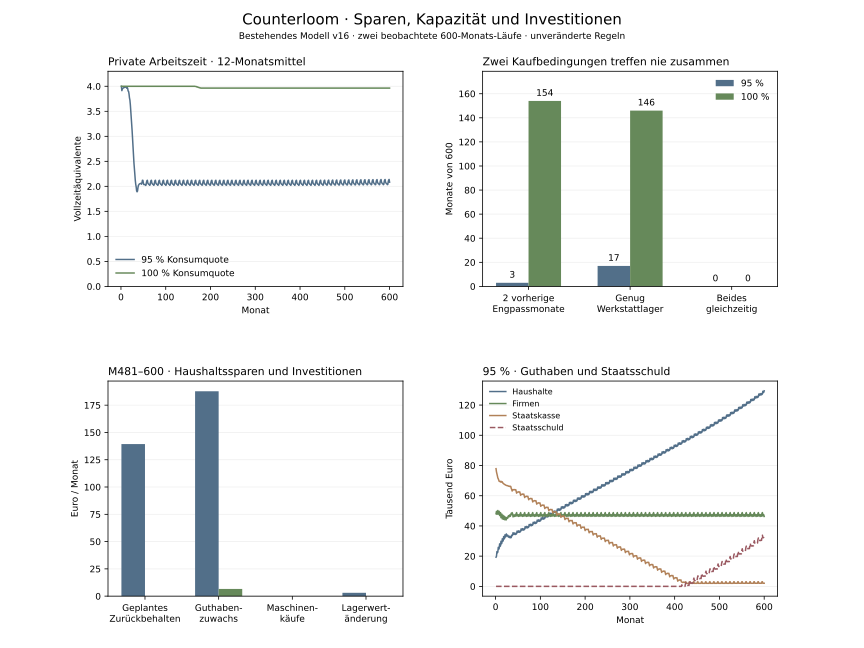

# Firmenreaktionen Sparen und Investitionen

Stand: 3. November 2026. Eigener simulierter Befund des bestehenden Modells v16. Alle Verhaltensregeln und Anfangswerte bleiben unverändert; nur die bereits archivierten Konsumquoten 95 und 100 % unterscheiden sich.

Die 95-%-Variante leidet langfristig überwiegend unter fehlender Nachfrage, nicht unter zu geringer Maschinenkapazität. Gleichzeitig verstärken getrennte Personal- und Arbeitszeitregeln sowie harte staatliche Defizitschwellen den Rückgang. Der Investitionspfad hat eine zusätzliche Beschränkung: Auch bei Engpässen wird nur aus dem nach den übrigen Käufen verbliebenen Werkstattlager investiert. In beiden Varianten kommt über 600 Monate kein Maschinenkauf zustande.



## Kapazität und tatsächliche Investitionen

| Kennzahl | 95 % | 100 % |
| --- | ---: | ---: |
| Private Vollzeitäquivalente im Mittel M481–600 | 2.0721 | 3.9637 |
| Monate mit unerfüllten Alltagsbestellungen | 5 | 302 |
| Monate mit unerfüllten Werkstattbestellungen | 129 | 55 |
| Maschinenkäufe insgesamt | 0,00 € | 0,00 € |
| Lagerwertänderung im Mittel M481–600 | 3,06 € | 0,03 € |

Vier private Vollzeitkräfte sind der Ausgangsbestand. Rund zwei Vollzeitäquivalente bei 95 % zeigen im langfristigen Mittel freie Arbeitszeit. Die Betriebe passen sich durch niedrigere Stunden an die geringeren Bestellungen an. Zusätzliche Maschinen wären damit kein belegter Ausgleich für das Sparen; bei gleichem Absatz könnten sie auch die benötigte Arbeit verringern. Dies ist ein möglicher Gegenmechanismus, kein ausgeführter Investitionsgegenlauf. Lagerwertänderungen sind reale Bestandsinvestitionen in der BIP-Näherung und werden deshalb getrennt von Maschinenkäufen ausgewiesen.

## Die bestehende Maschinenregel blockiert auch bei hoher Nachfrage

Nur Alltag & Versorgung kann autonom eine Maschine von Werkstatt & Technik kaufen. Der Kauf erfordert zwei vorherige aufeinanderfolgende Monate mit unerfüllten finanzierbaren Bestellungen, drei Monate Abstand zum letzten Kauf, Geld oberhalb des Betriebspuffers und acht ursprüngliche Werkstatteinheiten als freie Ware. Bei der aktuellen Stückelung sind das 800 Teile für anfangs 1.200 Euro. Der separate Bankkredit wird nur auf ausdrückliche Anfrage ausgelöst; die beiden Baselines enthalten keine Anfrage.

| Beobachtete Kaufbedingung | 95 % | 100 % |
| --- | ---: | ---: |
| Zwei vorherige Engpassmonate | 3 | 154 |
| Ausreichendes freies Werkstattlager | 17 | 146 |
| Beide Bedingungen gleichzeitig | 0 | 0 |
| Geld einschließlich Betriebspuffer vorhanden | 600 | 600 |

Bei 95 % ist die Engpassbedingung nur in M6–8 erfüllt; dort verbleiben 148, 0 und 274 Werkstattteile. Bei 100 % ist sie deutlich häufiger erfüllt, trifft aber ebenfalls nie auf mindestens 800 freie Teile. Haushalte, öffentliche Beschaffung und Exporte kaufen vor der Investitionsphase. Es gibt weder eine Maschinenvorbestellung noch eine dafür geplante Produktion; die Werkstatt kann ihrerseits nicht investieren. Die Beobachtung belegt eine Beschränkung des bestehenden Investitionskanals. Wie stark eine andere Bestellreihenfolge oder Auftragsproduktion den Gesamtverlauf verändern würde, ist hier nicht isoliert gemessen.

Der Kanal bildet ausschliesslich Kapazitätserweiterung nach Absatzengpässen ab. Anlagen verschleissen nicht; Ersatzinvestitionen, eigenständig bewertete Modernisierungsprojekte und ein öffentlicher Kapitalstock fehlen. Staatliche Warenkäufe gelten in der bestehenden BIP-Näherung als öffentliche Güternachfrage, nicht als Aufbau produktiver Anlagen. Damit enthält das Modell keinen gesonderten Investitionszyklus, der unabhängig von aktuellen Lieferengpässen Nachfrage erzeugt. Das ist eine Modellgrenze und kein Beleg dafür, dass jeder Konsumverzicht durch Investitionen ausgeglichen werden müsste.

## Haushalte sparen mehr als der Kaufplan zurückhält

Die Konsumquote bezieht sich auf Nettoeinkommen einschließlich im Folgemonat verfügbarer Ausschüttungen. Ein Mindestbedarf kann vorhandenes Guthaben beanspruchen. Nicht erhältliche Ware und Rundung lassen zusätzlich Geld auf den Konten. Ausschüttungen nach der Kaufphase verändern den Monatsbestand, werden aber erst im nächsten Kaufplan berücksichtigt.

| Monatlicher Betrag M481–600 | 95 % | 100 % |
| --- | ---: | ---: |
| Vom Kaufplan zurückbehalten | 139,36 € | 0,00 € |
| Wegen fehlender Ware nicht ausgegeben | 42,79 € | 0,00 € |
| Rest durch Gütereinheiten | 5,22 € | 6,66 € |
| Unterschied aktueller und vorheriger Ausschüttungen | 0,34 € | -0,02 € |
| Tatsächlicher Haushaltsguthabenzuwachs | 187,72 € | 6,63 € |

Diese Bestandsgleichung wird für jeden Monat centgenau geprüft. 100 % Konsumquote bedeutet deshalb keine garantierte Nullersparnis. Bereits angesammeltes Vermögen führt über den Mindestbedarf hinaus zu keinem zusätzlichen Konsumplan. Ebenso gibt es keine eigenständige Vermögensanlage der Haushalte, die ihre Guthaben in zusätzliche Investitionsausgaben überführt. Eine solche Ausgabe müsste begründet modelliert werden; angespartes Geld allein löst sie nicht aus.

## Wo die Gegenbuchung zum Guthabenzuwachs liegt

| Monatliche Bestandsänderung M481–600 | 95 % | 100 % |
| --- | ---: | ---: |
| Haushaltsguthaben | 187,72 € | 6,63 € |
| Firmenguthaben | -3,06 € | -0,03 € |
| Staatsguthaben | 0,43 € | -0,03 € |
| Auslandsguthaben | -0,77 € | -19,63 € |
| Bankeigenkapital | 0,00 € | 0,00 € |
| Staatsschuld | 184,32 € | -13,06 € |

Im 95-%-Lauf wächst die Staatsschuld langfristig nahezu im Umfang des Haushaltsguthabenzuwachses; Firmen, Ausland und Staatskasse erklären die Differenz. Das ist ein beobachteter Finanzierungspfad, kein Naturgesetz zugunsten staatlicher Schulden oder Inflation. Die Konten verschwinden nicht aus der Bilanz. Ein dauerhafter privater Geldüberschuss benötigt in dieser Modellgrenze eine Gegenposition. Haushaltsguthabenzuwachs ist zudem nicht die volkswirtschaftliche Gesamtersparnis; der Vergleich mit Maschinenkäufen ist keine Prüfung der gesamtwirtschaftlichen Identität von Sparen und Investieren.

## Welche Firmenreaktion bisher nicht plausibel genug ist

Die [vorherige Personaldiagnose](firm-reactions-v16-diagnosis.md) zeigt 63 Entlassungen und 63 Wiedereinstellungen der Werkstatt bei 95 %, alle Entlassungen bei positivem Monatsgewinn. In M34 sinkt die gesamte geplante Arbeitszeit durch den Kopfzahlwechsel von 0,9266 auf 0,7133 Vollzeitäquivalente. Eine finanzierbare Zwei-Personen-Option mit je 51,28 % wäre verfügbar. Die Personalzahl nutzt eine andere Bedarfsgleichung als die Produktions- und Lagerplanung. Im Modell fehlen zugleich fixe Kosten je Beschäftigtem, die einen Kopfzahlabbau bei gleicher Gesamtarbeitszeit wirtschaftlich begründen könnten.

Die staatliche Dreimonatsschwelle vergrössert den Unterschied bereits vorher: In M9 stehen −34,17 Euro bei 95 % einem Überschuss von 21,70 Euro bei 100 % gegenüber. Nur die erste Variante löst eine zusätzliche Beschaffungskürzung von 600 Euro aus. Später fallen dort die öffentlichen Stellen weg. Niedrigere Einkommen und Steuern sowie höhere Transfers verstärken die Nachfragerückwirkung. Der feste Transfer von 1.000 Euro kann bei niedriger Teilzeit sogar über dem vorherigen Nettolohn liegen. Diese bereits belegten Regelwirkungen bleiben unverändert.

## Schlussfolgerung für die nächste Prüfung

Ein Rückgang von Bestellungen und Arbeitszeit ist nachvollziehbar. Die Grösse des Einbruchs und die wiederholten Kopfzahlwechsel sind durch die bestehenden Schwellen nicht hinreichend plausibilisiert. Fehlende Maschineninvestitionen sind bei 95 % langfristig kein nachgewiesener Kapazitätsmangel, bei 100 % aber ein sichtbarer Engpass des Investitionsablaufs. Beide Probleme müssen getrennt werden.

Zuerst sollte ein isolierter Gegenlauf gemeinsame Personal- und Arbeitszeitplanung prüfen, mit unveränderter Staats- und Investitionslogik. Danach lässt sich der Maschinenpfad gezielt auf Vorbestellung und Lieferfähigkeit prüfen. Zusätzliche Investitionsnachfrage, Inflation oder Wachstum als pauschaler Ausgleich würden die hier beobachteten Ursachen nicht einzeln prüfen. Kein solcher Eingriff wurde für diese Diagnose vorgenommen.

## Reproduktion

[Beobachtete Kaufbedingungen und sektorale Buchungen](saving-investment-v16-traces-2026-11-03.json) · [ursprünglicher Konsumvergleich](consumption-v16-comparison.md) · [Prüfprotokoll](saving-investment-v16-diagnosis-verification.json).

```sh
python poc/scripts/diagnose_saving_investment.py --output qa/saving-investment-v16-traces-2026-11-03.json
python poc/scripts/report_saving_investment.py --source qa/saving-investment-v16-traces-2026-11-03.json --output qa/saving-investment-v16-diagnosis
python -m unittest discover -s poc -p test_saving_investment_diagnosis.py -v
```

Beide 600-Monats-Verläufe reproduzieren die archivierten Monatskonten, Käufe, Beschäftigung, Staatsbudget, Staatsschuld, Steuern und Makrokomponenten exakt. Die Regeln bleiben v16. Eine zusätzliche Gleichheitsprüfung vergleicht Journal und ökonomische Geschichte einer unveränderten und einer beobachteten Welt über 45 Monate. Die Diagnose beschreibt diese Modellwelt und ist keine empirische Kalibrierung einer realen Volkswirtschaft.
