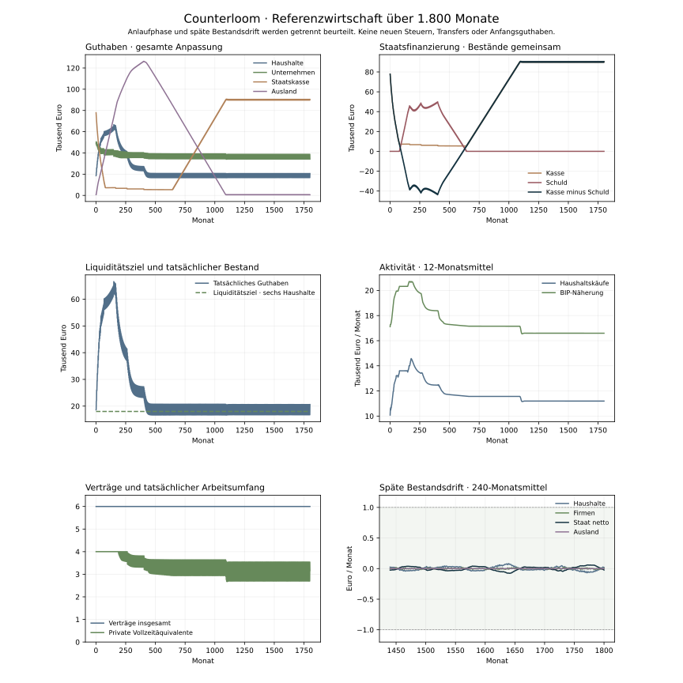

# Langzeitprüfung der stabilisierten Modellwirtschaft

Stand: 3. November 2026. Eigene deterministische Modellläufe v18; keine empirische Kalibrierung.

Die neue Referenz besteht die vorab festgelegte technische Stabilitätsprüfung bis Monat 1.800 und erreicht einen wirtschaftlich aktiven, näherungsweise stationären zyklischen Bereich. Der Lauf mit leicht anderer Anfangsverteilung besteht ebenfalls. Die Anlaufphase ist deutlich bewegt und darf nicht als bereits stationär bezeichnet werden. Auch ein positiver Befund über 1.800 Monate beweist keine unbegrenzte Stabilität unter beliebigen Annahmen.



## Was verändert wurde

Die [Regeln v18](../poc/STABILITY_MODEL.md) verbinden vier getrennte Mechanismen: gemeinsame Kopfzahl-/Arbeitszeitplanung, vollständige Quartalsbasis mit ausgewiesenem Finanzierungsraum, finanzierte Maschinenaufträge mit Produktionsplanung sowie eine eigene Haushaltsregel mit Liquiditätsziel. Die Oberfläche startet diese Kombination. Historische Regeln bleiben kontrollierbar; frühere Ergebnisdateien wurden nicht überschrieben. Steuern, Transfers, Lohnsatz, Anfangsguthaben und Kreditlimit wurden nicht auf das Ergebnis angepasst.

Die Reserveannahme lautet drei Monate Grundbedarf je Haushalt, mit Anpassung über zwölf Monate. Die neue Referenz verwendet 100 % der Einkommensbasis plus Reservekorrektur; das ist eine eigene Regel und keine Umbenennung der bisherigen 95-%-Variante. Der fiskalische Planungshorizont beträgt zwölf Monate. Alle drei Parameter sind illustrative Annahmen.

## Vorab festgelegte Prüfkriterien

Jede Phase prüft Geld, Bankbilanz, Forderungen, Finanzierung und Lager. Das Journal wird zusätzlich unabhängig anhand jeder Soll-/Habenbewegung rekonstruiert. Kein gebuchter Kontostand darf negativ sein. Ein Auftrag darf keine Doppelbestellung, vorgezogene Kapazität oder fiktiven Teilumsatz erzeugen.

Für den langen Referenzlauf gelten die festen Fenster M1321–1560 und M1561–1800: höchstens 1 Euro durchschnittliche nominale Bestandsänderung je Monat und Sektor, einschliesslich Staatsschuld und Kasse minus Schuld. Der reale Lagerbestand darf je Betrieb durchschnittlich höchstens einen Warenteil pro Monat driften. Produktion und Käufe müssen positiv bleiben; ungedeckte geplante Grundkäufe und Sozialzahlungen werden gesondert geprüft. Diese Grenzen sind technische Toleranzen, keine empirischen Parameter.

## Späte Bestandsänderungen

| Bestand | M1321–1560 pro Monat | M1561–1800 pro Monat |
| --- | ---: | ---: |
| Haushalte | 0,03 € | 0,02 € |
| Unternehmen | 0,00 € | 0,01 € |
| Staatskasse | -0,03 € | -0,02 € |
| Staatsschuld | 0,00 € | 0,00 € |
| Staat netto | -0,03 € | -0,02 € |
| Ausland | 0,00 € | 0,00 € |
| Bankeigenkapital | 0,00 € | 0,00 € |

## Aktivität und Anlaufphase

Nach 1.800 Monaten bestehen 6 Arbeitsverträge, davon 2 öffentliche. Im letzten 240-Monats-Fenster betragen die privaten Vollzeitäquivalente im Mittel 3,1344; Haushaltskäufe 11.195,72 € je Monat. Die Staatsschuld erreicht während des Laufs höchstens 49.928,73 € und beträgt zuletzt 0,00 €.

In der Anlaufphase verbleiben am höchsten Schuldenstand nur 71,27 € bis zur bestehenden Kreditgrenze von 50.000 Euro. Der Finanzierungsraum ist zeitweise knapp. Der Referenzbefund gilt deshalb nicht als allgemeine Freigabe anderer Anfangs- oder Schockannahmen.

Vorübergehende Guthabenanhäufung, Lieferengpässe, Investitionen und Staatsverschuldung gehören zur langen Anlaufphase. Der begrenzte Auslandsanschluss führt Geld zeitweise langsam zurück. Null Schuld allein ist deshalb kein Erfolgskriterium; der vollständige Verlauf und die späte Nettoposition stehen nebeneinander. Ein Bestand über dem Haushaltsziel kann wegen begrenzter Ware bestehen bleiben, ohne weiterhin zu wachsen. Das Ziel ist keine Garantie exakt erreichter Kontostände.

Auch einzelne Haushalte verarmen nicht verborgen hinter einem stabilen Aggregat: Der grösste absolute Einzelhaushaltstrend in beiden späten Fenstern beider langen Läufe beträgt 1,06 Cent je Monat. Quartalsausschüttungen und Kaufreihenfolgen erzeugen trotzdem deutliche Monatszyklen. Im späten Referenzfenster liegt der Konsum zwischen 9.797,00 € und 13.084,00 €. Die separate KI-Prüfinstanz hat diese Drifts und die nahezu unveränderten Schwankungshüllen unabhängig nachgerechnet.

## Isolierte Kontrollen und Sensitivitäten

| Variante | Monate | Später Staat netto pro Monat | Späte Haushaltsdrift pro Monat | Technischer Screen |
| --- | ---: | ---: | ---: | --- |
| [Neue Referenz](stability-v18/stable.json) | 1800 | -0,02 € | 0,02 € | Bestanden |
| [Nur gemeinsame Personalplanung · Einkommen95](stability-v18/joint_only.json) | 600 | -115,48 € | 115,49 € | Nicht bestanden |
| [Zusätzlich reine Quartals-Nullschwelle](stability-v18/quarter_only.json) | 600 | -115,48 € | 115,48 € | Nicht bestanden |
| [Zusätzlich Maschinenaufträge · Einkommen95](stability-v18/orders_income95.json) | 600 | -117,64 € | 117,64 € | Nicht bestanden |
| [Neue übrige Regeln · historische Einkommensquote95](stability-v18/income95.json) | 600 | -3,85 € | 4,25 € | Nicht bestanden |
| [Nur harte Vorfinanzierung beim Staat](stability-v18/funding_only.json) | 600 | -5,12 € | 21,39 € | Nicht bestanden |
| [Liquiditätsziel 1 Monat](stability-v18/reserve1.json) | 600 | 137,07 € | -28,81 € | Nicht bestanden |
| [Liquiditätsziel 6 Monate](stability-v18/reserve6.json) | 600 | 175,48 € | -27,56 € | Nicht bestanden |
| [Reserveanpassung über 6 Monate](stability-v18/adjust6.json) | 600 | 188,10 € | -8,15 € | Nicht bestanden |
| [Reserveanpassung über 24 Monate](stability-v18/adjust24.json) | 600 | 62,36 € | -54,80 € | Nicht bestanden |
| [Fiskalhorizont 6 Monate](stability-v18/fiscal6.json) | 600 | 165,88 € | -28,20 € | Nicht bestanden |
| [Fiskalhorizont 24 Monate](stability-v18/fiscal24.json) | 600 | 127,25 € | -28,32 € | Nicht bestanden |
| [300 Euro zwischen zwei Haushalten umverteilt](stability-v18/initial_distribution.json) | 1800 | -0,02 € | 0,02 € | Bestanden |
| [Energie Zins und Betriebsschliessung](stability-v18/shocks.json) | 600 | 267,75 € | 0,00 € | Nicht bestanden |

Bei 600-Monats-Varianten beziehen sich die zwei Fenster auf M121–360 und M361–600. Diese Varianten sind Gegenläufe und frühe Sensitivitätsprüfungen, kein zusätzlicher Langzeitnachweis. Ein nicht bestandener Screen wird nicht durch eine nachträglich gelockerte Toleranz ersetzt. Unterschiedliche Reserven und Reaktionsgeschwindigkeiten können andere Übergangs- und Finanzierungsverläufe erzeugen.

Der Schocklauf verdoppelt Energiepreise ab M120 und normalisiert sie ab M144, erhöht den Leitzins ab M180 auf 5 % und stellt ihn ab M216 auf 2 % zurück. Ab M240 schliessen beide Betriebe für drei Monate bei 60 % Nettoersatz. Ein solcher Lauf darf Verluste, ungedeckten Sozialbedarf, Arbeitsplatzverluste oder Finanzierungsgrenzen enthalten. Eine begründete Krise gilt nicht als Buchungsfehler; ihre Folgen bleiben in den Rohdaten sichtbar.

## Prüfung und Reproduktion

Die vollständige Python-Suite umfasst 194 bestandene Tests. Die separate Codeprüfung fand einen blockierten Wiederanlauf bei Maschinenaufträgen und einen falsch datierten fiskalischen Beobachtungswert; beide sind durch gezielte Regressionstests behoben. Die endgültigen Läufe verwenden die korrigierten Quellstände. 26 Snapshots an Phasen-, Auftrags-, Schliessungs-, Energie- und Zinsgrenzen bestehen zusätzlich den strikten Oberflächenvertrag. Die historischen 95-/100-%-Profile wurden im neuen Kern jeweils über 600 Monate erneut ausgeführt und stimmen in sämtlichen archivierten wirtschaftlichen Monatsfeldern exakt überein. Nur der erläuternde Wortlaut einer Budgetentscheidung ist vom Vergleich ausgenommen; [Reproduktionsnachweis](stability-v18-historical-replay.json).

Die Matrix enthält 10.800 simulierte Monate und 54.000 einzeln geprüfte Phasen. Jede Rohdatei enthält Eingaben, Quellprüfsummen, Monatswerte, Bestandsdrifts und Prüfergebnisse. [Modellregeln](../poc/STABILITY_MODEL.md) · [Prüfplan](../poc/STABILITY_PLAN.md) · [Prüfprotokoll](stability-v18-verification.json).

```sh
python -m unittest discover -s poc -v
python poc/scripts/check_stability.py --case stable
python poc/scripts/check_stability.py --case initial_distribution
python poc/scripts/stability_contract_fixtures.py
node --experimental-strip-types poc/scripts/check_stability_contract.mts
python poc/scripts/report_stability.py
```

Die weiteren Fallnamen stehen in `CASES` im Prüflaufskript. Der Bericht wird erst erzeugt, wenn alle vorgesehenen Dateien zum aktuellen Quellstand vorliegen. Matplotlib erzeugt das Diagramm aus den gesicherten Monatsdaten.
