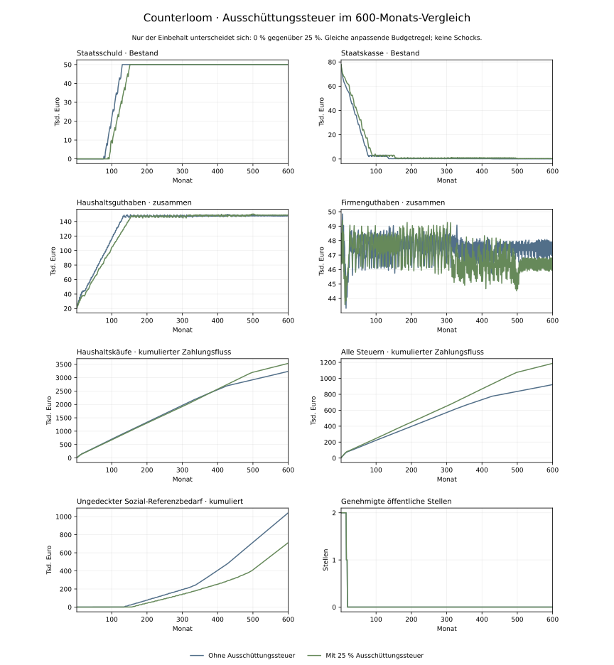

# Ausschüttungssteuer · kontrollierter 600-Monats-Vergleich

Stand: 3. November 2026 · Modell v14. Eigene illustrative Simulation, keine Prognose, empirische Kalibrierung oder Bewertung einer realen Steuerpolitik.

Der zusätzliche Einbehalt bringt über 600 Monate 188.318,43 € tatsächlich gezahlte Ausschüttungssteuer. Die Staatskreditgrenze wird statt in Monat 130 in Monat 152 erreicht. Die bezahlten Haushaltskäufe liegen über den gesamten Lauf um 9,3 % höher. Die Finanzierungsgrenze verschwindet nicht.

## Versuchsaufbau

Beide Läufe verwenden dieselben Anfangsbestände, Firmenregeln, quartalsweisen Zusatzausschüttungen, anpassenden öffentlichen Ausgaben und Kreditgrenzen. Nur die Ausschüttungssteuer unterscheidet sich: 0 gegenüber 25 %. Lohnsteuer (30 %) und Gewinnsteuer (20 %) bleiben unverändert. Es gibt keine externen Schocks, Zufallsziehungen oder LLM-Aufrufe.

Bruttoausschüttungen vermindern den Gewinnvortrag der Firma. Der Einbehalt ist eine Steuer der Eigentümerhaushalte und kein weiterer Firmenaufwand. Erfasst werden reguläre und zusätzliche Firmenausschüttungen sowie tatsächliche Zinsausschüttungen der Bank. Jeder Haushalt versteuert seine über den Monat kumulierten Bruttobeträge; Cent-Rundung erfolgt auf dieser Summe. Nur Nettozahlungen gehen in die nächste Kaufrunde ein.

Der Nullsteuerzweig stimmt in jedem der 600 Monate bei Haushalts-, Firmen-, Staats- und Auslandsguthaben, Staatsschuld, Konsum, Produktion, Beschäftigung und offenen öffentlichen Löhnen exakt mit dem archivierten anpassenden v13-Lauf überein. Dieser historische Befund bleibt unverändert.



## Grenzen und Endbestände

| Grösse | Ohne Einbehalt | Mit 25 % Einbehalt |
| --- | ---: | ---: |
| Haushaltsguthaben · M600 | 148.838,02 € | 149.145,28 € |
| Firmenguthaben · M600 | 46.724,27 € | 45.958,00 € |
| Staatskasse · M600 | 117,71 € | 580,72 € |
| Staatsschuld · M600 | 50.000,00 € | 50.000,00 € |
| Haushaltskäufe · nur M600 | 2.550,00 € | 3.300,00 € |
| Offene öffentliche Löhne · M600 | 0,00 € | 0,00 € |
| Staatskreditgrenze erreicht | M130 | M152 |
| Erster ungedeckter Sozialbedarf | M136 | M157 |
| Erste Reduktion öffentlicher Stellen | M16 | M16 |

## Zahlungsflüsse über alle 600 Monate

| Grösse | Ohne Einbehalt | Mit 25 % Einbehalt |
| --- | ---: | ---: |
| Alle Steuereingänge | 921.570,40 € | 1.188.007,33 € |
| Davon Ausschüttungssteuer | 0,00 € | 188.318,43 € |
| Bezahlte Haushaltskäufe | 3.236.250,00 € | 3.536.350,00 € |
| Ungedeckter Sozial-Referenzbedarf | 1.042.634,33 € | 712.571,97 € |
| Tatsächlich ausgezahlte Sozialleistungen | 892.365,67 € | 1.160.428,03 € |

Geld kann mehrfach als Kauf und Steuerzahlung umlaufen. Kumulierte Steuer- oder Konsumflüsse sind deshalb keine zusätzlichen Geldbestände. Die Differenz aller Steuereinnahmen ist grösser als die neue Ausschüttungssteuer allein: veränderte Käufe beeinflussen Umsätze, Gewinne und damit weitere Steuerzahlungen.

## Interpretation

Die breitere Steuerbasis verschiebt Geld von Eigentümerhaushalten in die Staatskasse. Im Modell kann der Staat dadurch länger Zahlungen leisten. Das verändert Nachfrage, Firmenentscheidungen und spätere Ausschüttungen. Ein niedrigeres verfügbares Ausschüttungseinkommen bedeutet hier daher nicht automatisch niedrigere Käufe über den gesamten Lauf.

Beide Varianten genehmigen insgesamt 33 öffentliche Stellenmonate; die zusätzliche Steuer verhindert in diesem Parametersatz den Abbau öffentlicher Stellen nicht. Beide erreichen den Kreditdeckel von 50.000 €. Der ungedeckte Sozialbedarf bleibt erheblich. Die Steuer verbessert die Liquiditätsverwendung unter diesen Regeln, liefert aber keinen Nachweis einer langfristig tragfähigen Modellwirtschaft.

Die sechs Haushalte besitzen gleiche Unternehmensanteile, haben jedoch unterschiedliche Beschäftigungsverläufe. Die Vermögensverteilung bleibt ungleich; ein ähnlicher Gesamtbestand allein beschreibt weder individuelle Lebenslagen noch Wohlfahrt. Öffentliche Dienstleistungen, Vermögensprüfungen, Freibeträge, Steuervermeidung, Insolvenz und ein Anleihemarkt sind nicht ergänzt worden.

## Haushalte einzeln · M600

| Haushalt | Guthaben ohne Steuer | Guthaben mit Steuer | Arbeitgeber mit Steuer |
| --- | ---: | ---: | --- |
| h1 | 67.623,12 € | 72.231,40 € | alltag |
| h2 | 251,47 € | 234,68 € | ohne Arbeitsvertrag |
| h3 | 79.717,06 € | 75.939,43 € | werkstatt |
| h4 | 408,16 € | 257,85 € | ohne Arbeitsvertrag |
| h5 | 415,39 € | 236,50 € | ohne Arbeitsvertrag |
| h6 | 422,82 € | 245,42 € | ohne Arbeitsvertrag |

## Nachvollziehbarkeit und Reproduktion

[Monatsdaten, Steuerarten und Quellprüfsummen](tax-v14-comparison-2026-11-03.json) · [Modellregeln](../poc/DISTRIBUTION_TAX_MODEL.md) · [Historischer v13-Vergleich](fiscal-v13-comparison.md).

Vom Repository-Stamm mit der eingerichteten Python-Umgebung:

```sh
poc/.venv/bin/python poc/scripts/compare_distribution_tax.py --months 600
python poc/scripts/report_distribution_tax.py --source .framework-review/distribution-tax-comparison.json --output .framework-review/tax-v14-comparison
```

Matplotlib wird nur für die Abbildung benötigt. Die datierten archivierten Befunde werden von diesen Standardbefehlen nicht überschrieben.
